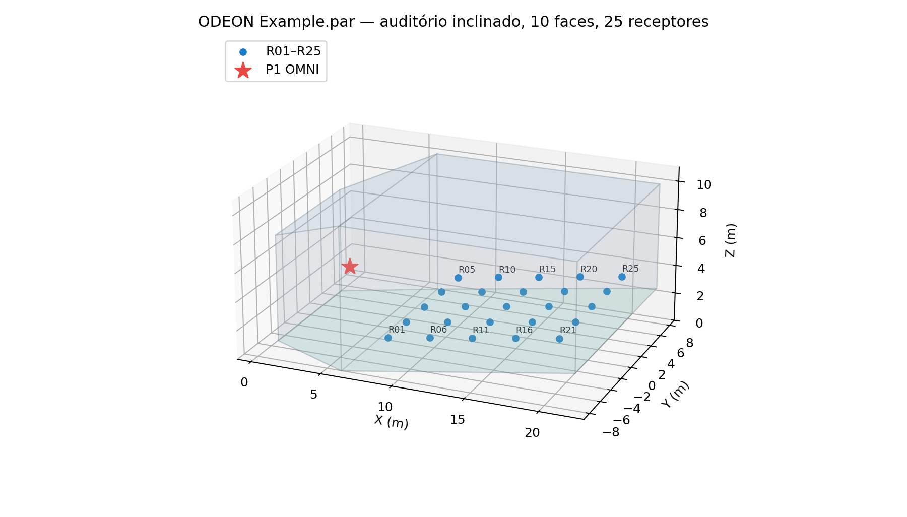
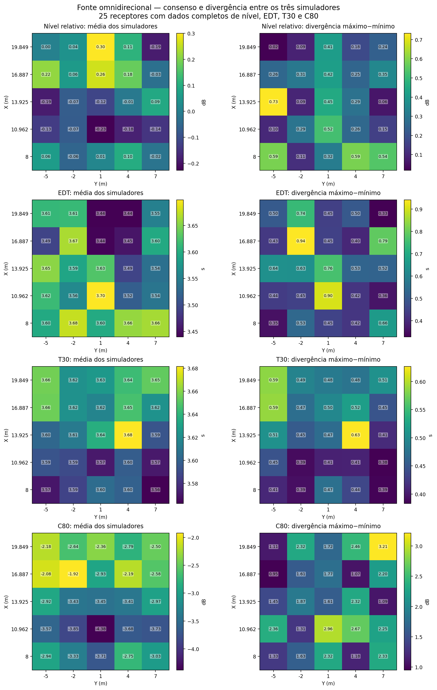
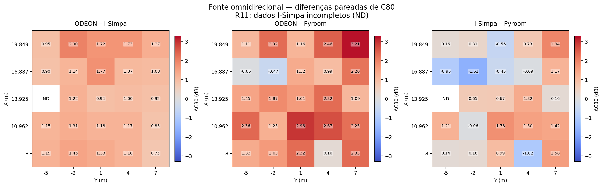
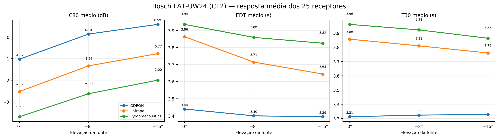
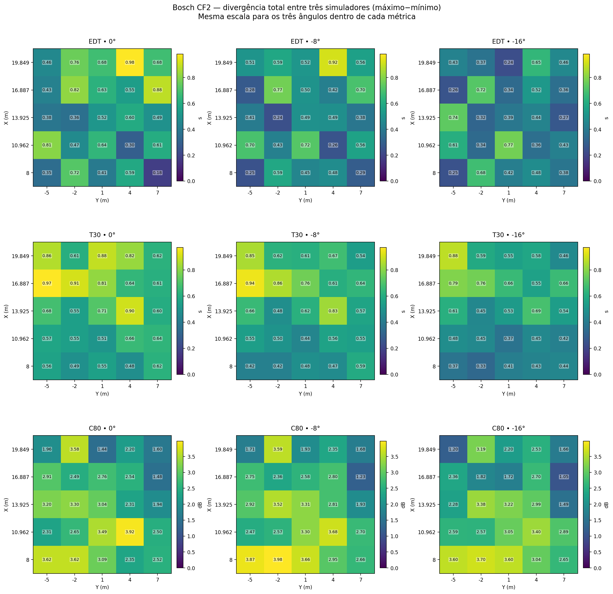
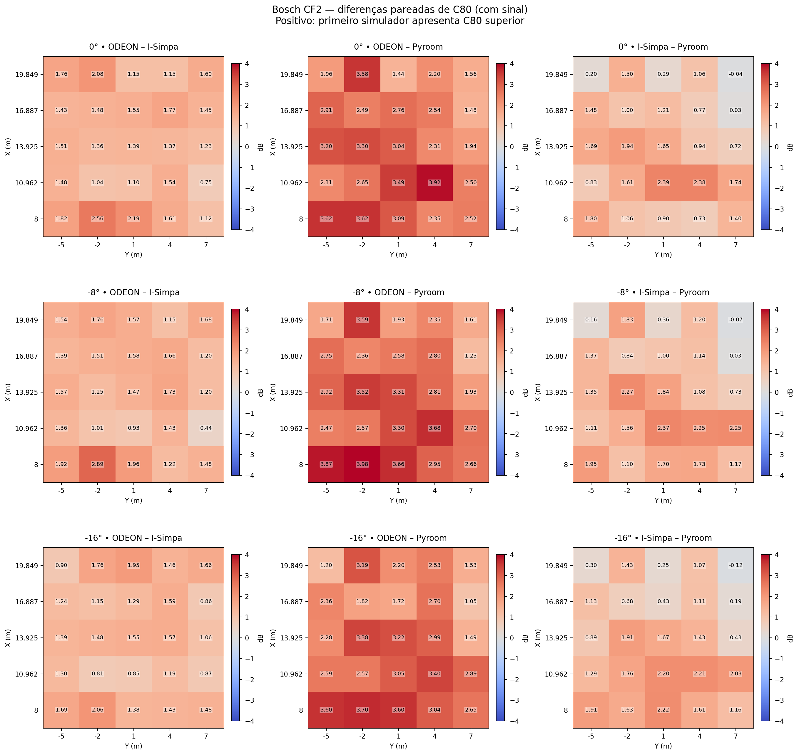
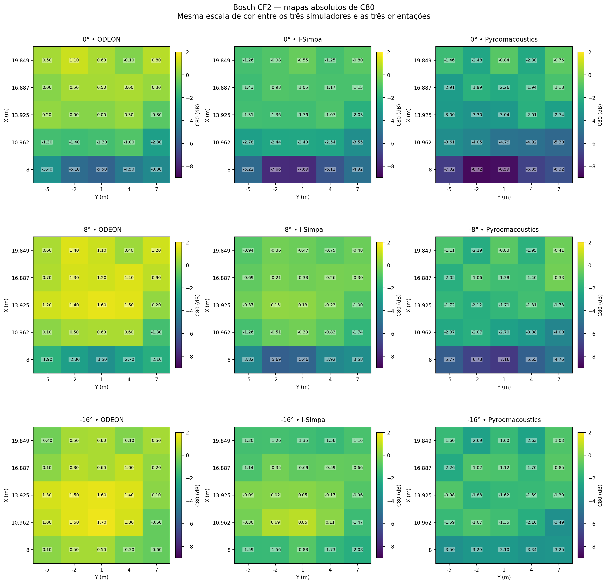
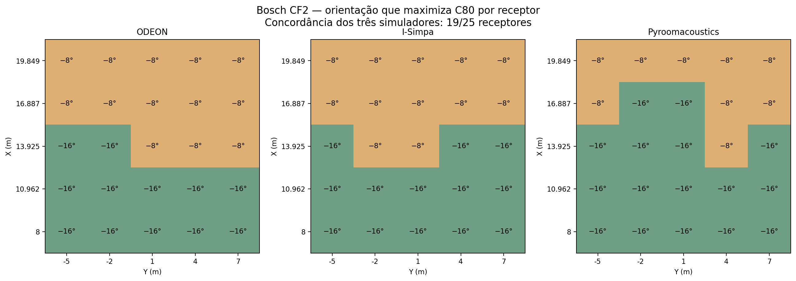

# Relatório técnico — benchmark acústico de três simuladores

**Comparação ODEON 19.12 × I-Simpa 1.3.4 (SPPS) × Pyroomacoustics**  
**Cenários:** fonte omnidirecional e Bosch LA1-UW24.CF2 (0°, −8°, −16°)  
**Data de consolidação:** 16 de outubro de 2026 — revisão com o ZIP I-Simpa `2026-10-16_21h04m27s.zip`  
**Natureza:** análise numérica comparativa entre simuladores, sem validação experimental contra medições físicas.

> **Resumo executivo.** No cenário omnidirecional, os três métodos apresentam divergência média de **0,305 dB** nos perfis de nível relativo (25 receptores), **0,545 s** em EDT, **0,467 s** em T30 e **1,884 dB** em C80 (25 receptores com parâmetros temporais completos). Com a fonte direcional Bosch CF2, os três simuladores indicam a **melhor média espacial de C80 em −16°**, apesar das diferenças absolutas. O melhor ângulo por receptor coincide nos três programas em **19/25** posições.

## 1. Objetivos e questões de pesquisa

Este trabalho compara o comportamento de três motores de simulação acústica ao reproduzir uma mesma geometria de auditório, posições de fonte e receptores e propriedades de absorção próximas. Os objetivos são: (i) quantificar divergências espaciais em **nível, EDT, T30 e C80**; (ii) distinguir a diferença inicial entre algoritmos (fonte OMNI) dos efeitos adicionais da diretividade; e (iii) verificar se o **ranking de orientações** permanece consistente, mesmo na presença de vieses sistemáticos. Os resultados apoiam o desenvolvimento posterior de otimização de posição e orientação de fontes sonoras, mas não estabelecem a superioridade física de nenhum simulador.

## 2. Geometria e receptores

- **Modelo:** `Example.par` do ODEON, auditório com arquibancada/piso inclinado, descrito por dez superfícies. Não se trata da sala retangular 6 × 5 × 3 m usada nos testes anteriores.
- **Fonte P1:** posição (X, Y, Z) = **(3, 0, 4) m**, no mesmo sistema de coordenadas do auditório.
- **Receptores:** 25 pontos R01–R25, distribuídos em grade 5 × 5 no espaço. Coordenadas X = 8,000; 10,962; 13,925; 16,887; 19,849 m; Y = −5; −2; 1; 4; 7 m. A cota Z acompanha a inclinação da sala.
- **Absorção nominal:** α = 0,10 nas superfícies do cenário de referência. É importante validar sua atribuição efetiva em cada projeto e banda.



*Figura 1 — Reconstrução visual do auditório Example.par, com a fonte e os 25 receptores.*

## 3. Condições computacionais e metodologia

### 3.1. Ferramentas e parâmetros registrados

| Critério | ODEON | I-Simpa | Pyroomacoustics |
| --- | --- | --- | --- |
| Simulador | ODEON 19.12 Combined, instalação de demonstração | I-Simpa 1.3.4, módulo SPPS | Execuções anteriores em Google Colab |
| Fonte OMNI | `Omni.SO8` | OMNI | OMNI |
| Fonte direcional | `LA1_UW24.CF2` | Balloon convertido para texto EASE | Adaptador direcional baseado em CF2 |
| Algoritmo | Modelo híbrido próprio | Propagação por partículas sonoras, **Energetic** | Método híbrido ISM/traçado de raios na execução usada |
| Configuração relevante | 1.000 raios tardios, conforme exportação ODEON; transição e espalhamento a auditar | 500.000 partículas, semente 123, raio de receptor 0,31 m, passo 10 ms | Resultados da execução com 50.000 raios |
| Faixa analisada | Oitava central de 1000 Hz | 800, 1000 e 1250 Hz agregados no campo *Global* | Oitava de 1000 Hz reconstruída conforme o processamento anterior |
| Duração da resposta | Parâmetros extraídos de exportações ODEON | 8 s | Depende da resposta impulsiva gerada; manter protocolo de processamento documentado |

**Normalização espectral:** no caso direcional o ODEON utiliza a potência declarada no CF2 com **ganho extra de 0 dB**; no I-Simpa foi usado **Lw global = 107,2 dB**, com espectro por terços de oitava aproximado energeticamente a partir das potências por oitava do Bosch. Isso não garante equivalência de todos os detalhes espectrais, especialmente fora de 1000 Hz. No caso OMNI, ODEON e I-Simpa usam aproximadamente 70,4 dB por oitava na faixa investigada. O SPL absoluto entre ferramentas **não foi validado** para o conjunto de três motores.

**Configuração geométrica:** as coordenadas dos receptores coincidem nos conjuntos utilizados, sujeitas a arredondamentos. A identidade geométrica, os fatores de dispersão (*scattering*), a absorção do ar e o comportamento do método híbrido requerem uma auditoria adicional para atribuir causalidade às diferenças.

### 3.2. Indicadores e cálculo das divergências

Para cada receptor `r`, indicador `M` e simulador `s`, foi utilizado o valor `M(s,r)`. A média dos três simuladores **não é uma referência experimental**, mas apenas um resumo descritivo:

```text
Consenso(r) = [ODEON(r) + I-Simpa(r) + Pyroom(r)] / 3
Divergência(r) = max(ODEON(r), I-Simpa(r), Pyroom(r))
               - min(ODEON(r), I-Simpa(r), Pyroom(r))
Diferença A−B(r) = M(A,r) − M(B,r)
Viés A−B = média das diferenças pareadas nos receptores válidos
RMSE A−B = raiz quadrada da média de [M(A,r) − M(B,r)]²
```

- **EDT** (*Early Decay Time*), em segundos: extrapolação do início do decaimento energético.
- **T30/RT30**, em segundos: tempo de reverberação estimado pela regressão do decaimento entre aproximadamente −5 e −35 dB, extrapolado a 60 dB.
- **C80**, em dB: razão logarítmica entre energia recebida nos primeiros 80 ms e energia posterior.
- **Nível relativo**, em dB: **G centrado** no ODEON e **SPL centrado** no I-Simpa/Pyroom, subtraindo a média espacial própria de cada ferramenta. Isso permite comparar **a forma da distribuição**, não o SPL absoluto nem a equivalência direta entre grandezas físicas distintas.

## 4. Resultados — fonte omnidirecional

**Atualização do conjunto OMNI.** O novo ZIP `2026-10-16_21h04m27s.zip` inclui os arquivos `Acoustic parameters.gabe` e `Schroeder curves.gabe` de **R11**, ausentes da exportação anterior. A geometria (`mesh.cbin`) é idêntica e os parâmetros numéricos dos outros 24 receptores não mudaram. Agora são **25/25 receptores com dados válidos** de SPL, EDT, T30, C80, C50, D50 e Ts no I-Simpa. As estatísticas e os mapas foram recalculados com os 25 pontos, sem qualquer interpolação.

| Receptor recuperado | SPL (dB) | EDT (s) | T30 (s) | C80 (dB) | C50 (dB) | Ts (ms) |
| --- | ---: | ---: | ---: | ---: | ---: | ---: |
| R11 — (13,925; −5,000; 2,468) m | 55,289 | 3,661 | 3,740 | −3,101 | −5,887 | 274,63 |

### 4.1. Médias dos três simuladores e faixa de divergência

| Parâmetro | N | ODEON | I-Simpa | Pyroom | Divergência média |
| --- | --- | --- | --- | --- | --- |
| Nível relativo (dB) | 25 | -0,000 | -0,000 | 0,000 | 0,305 |
| EDT (s) | 25 | 3,267 | 3,661 | 3,791 | 0,545 |
| T30 (s) | 25 | 3,317 | 3,754 | 3,770 | 0,467 |
| C80 (dB) | 25 | -2,052 | -3,260 | -3,725 | 1,884 |


A última coluna é a média espacial de `máximo−mínimo`, e **não** o máximo dos três valores médios da tabela. O nível é **relativo** e está centrado individualmente; consequentemente, as médias ficam perto de zero por construção.



*Figura 2 — Para cada métrica, à esquerda a média dos valores dos três simuladores e à direita a divergência máxima entre eles. Todos os 25 receptores possuem observações válidas nos três simuladores.*

### 4.2. Comparações pareadas

| Parâmetro | Par | N | Viés A−B | RMSE |
| --- | --- | --- | --- | --- |
| EDT | ODEON − ISimpa | 25 | -0,394 | 0,398 |
| EDT | ODEON − Pyroom | 25 | -0,524 | 0,556 |
| EDT | ISimpa − Pyroom | 25 | -0,130 | 0,226 |
| T30 | ODEON − ISimpa | 25 | -0,437 | 0,438 |
| T30 | ODEON − Pyroom | 25 | -0,452 | 0,459 |
| T30 | ISimpa − Pyroom | 25 | -0,016 | 0,062 |
| C80 | ODEON − ISimpa | 25 | 1,208 | 1,247 |
| C80 | ODEON − Pyroom | 25 | 1,673 | 1,899 |
| C80 | ISimpa − Pyroom | 25 | 0,465 | 1,022 |




*Figura 3 — Diferenças de C80 com sinal. Positivo significa que o primeiro simulador estima maior clareza. A comparação inclui agora R11 e os outros 24 receptores.*

**Leitura:** diferenças temporais relativamente estáveis e o desvio de C80 evidenciam ausência de equivalência perfeita entre os motores. No caso OMNI a diferença média dos perfis de nível relativo é pequena, mas isso **não prova concordância de SPL absoluto**, dada a centralização e o uso do G em ODEON.

### 4.3. Controle de alteração no conjunto OMNI

A nova exportação conserva os parâmetros principais (`computation_method=1`, 500.000 partículas, semente 123, 8 s de simulação, receptor com raio de 0,31 m, absorção atmosférica desativada) e a mesma malha. Os arquivos acústicos dos outros 24 receptores reproduzem os mesmos valores da versão anterior. Assim, qualquer variação entre as médias OMNI publicadas nesta revisão e na versão anterior decorre **exclusivamente da inclusão de R11**, não de um novo cenário geométrico ou de uma nova amostra estocástica identificada.

## 5. Resultados — alto-falante Bosch LA1-UW24.CF2

### 5.1. Controle de variáveis e execução

Foram estudadas **três elevações**: 0°, −8° e −16°, com o mesmo ponto de emissão, geometria, 25 receptores e espectro de potência nominal. Nos ZIPs do I-Simpa, as orientações são documentadas pelos vetores `(1,0,0)`, `(0,9903,0,−0,1392)` e `(0,9613,0,−0,2750)`, respectivamente. Os três trabalhos preservam os mesmos bytes de malha e arquivo de diretividade EASE. Foram selecionadas as bandas 800, 1000 e 1250 Hz no SPPS, agregadas para a comparação com a oitava de 1000 Hz do ODEON.

### 5.2. Valores médios dos 25 receptores

| Indicador | Elevação | ODEON | I-Simpa | Pyroom | Divergência média |
| --- | --- | --- | --- | --- | --- |
| EDT (s) | 0° | 3,439 | 3,863 | 3,935 | 0,572 |
| EDT (s) | -8° | 3,399 | 3,714 | 3,859 | 0,499 |
| EDT (s) | -16° | 3,394 | 3,644 | 3,825 | 0,449 |
| T30 (s) | 0° | 3,312 | 3,856 | 3,960 | 0,672 |
| T30 (s) | -8° | 3,324 | 3,810 | 3,922 | 0,610 |
| T30 (s) | -16° | 3,329 | 3,760 | 3,863 | 0,539 |
| C80 (dB) | 0° | -1,024 | -2,524 | -3,696 | 2,674 |
| C80 (dB) | -8° | 0,144 | -1,333 | -2,626 | 2,773 |
| C80 (dB) | -16° | 0,592 | -0,766 | -1,999 | 2,596 |




*Figura 4 — Variação das médias espaciais por inclinação nos três simuladores. Os resultados sugerem melhoria de C80 com a inclinação, mas o melhor ponto observado não deve ser extrapolado para orientações não testadas.*

### 5.3. Divergência espacial simultânea



*Figura 5 — Matriz de calor das divergências `máximo−mínimo` para EDT, T30 e C80 nas três elevações. Uma escala comum foi utilizada dentro de cada indicador, permitindo comparar os ângulos.*

No CF2, as divergências médias na grade, em C80, foram: **2,674 dB (0°)**, **2,773 dB (−8°)** e **2,596 dB (−16°)**. Essas divergências não são erros contra uma verdade de referência; expressam apenas o intervalo de estimativas entre motores.

### 5.4. Quem difere de quem: mapas pareados e valores absolutos



*Figura 6 — Comparações pareadas de C80, mantendo o sinal da subtração, para os 25 receptores e as três orientações.*



*Figura 7 — Valor absoluto de C80 por simulador e ângulo, em escala de cor compartilhada. A semelhança de padrões espaciais pode coexistir com diferentes níveis médios.*

Em relação ao ODEON, o I-Simpa apresenta o seguinte viés e RMSE (I-Simpa − ODEON):

| Elevação | Parâmetro | Viés I-Simpa − ODEON | RMSE |
| --- | --- | --- | --- |
| 0° | EDT | 0,424 | 0,451 |
| 0° | T30 | 0,544 | 0,554 |
| 0° | C80 | -1,500 | 1,549 |
| -8° | EDT | 0,315 | 0,356 |
| -8° | T30 | 0,486 | 0,491 |
| -8° | C80 | -1,477 | 1,539 |
| -16° | EDT | 0,250 | 0,291 |
| -16° | T30 | 0,430 | 0,435 |
| -16° | C80 | -1,358 | 1,399 |


### 5.5. Seleção do melhor ângulo por receptor

O ranking foi determinado por **maior C80 entre as três orientações medidas**, separadamente para cada receptor, sem arredondamento adicional. Os resultados são:

- **ODEON × I-Simpa:** 22/25 receptores selecionam o mesmo ângulo.
- **ODEON × Pyroomacoustics:** 21/25.
- **I-Simpa × Pyroomacoustics:** 20/25.
- **Concordância dos três:** **19/25** (76%).
- **Orientação de maior C80 médio:** **−16° nos três simuladores**.
- **I-Simpa por receptor:** melhor C80 em −8° para 12 receptores e em −16° para 13 receptores.



*Figura 8 — O ângulo ótimo dentro do conjunto discreto estudado não é uniforme na sala: há diferenças entre receptores e entre motores. A concordância de 19/25 é descritiva para esta grade e este conjunto de três ângulos.*

### 5.6. Outros indicadores disponíveis no I-Simpa

| Elevação | SPL médio (dB) | Desvio espacial SPL (dB) | C50 médio (dB) | D50 médio (%) |
| --- | --- | --- | --- | --- |
| 0° | 70,413 | 0,765 | -3,711 | 31,420 |
| -8° | 70,828 | 0,545 | -2,446 | 37,593 |
| -16° | 70,787 | 0,426 | -1,981 | 39,916 |


No I-Simpa, **−8° maximiza levemente o SPL médio**, enquanto **−16° apresenta maior uniformidade de SPL** (menor desvio espacial). Sem a calibração de níveis absolutos de todos os motores, esta análise de SPL é **interna ao I-Simpa**.

## 6. Discussão crítica

1. **O resultado mais robusto para otimização é o ranking de C80**, não a igualdade absoluta de resultados. A escolha de −16° por média espacial é comum aos três programas, e o melhor ângulo por receptor coincide em 19/25 posições.
2. **O T30 apresenta diferenças sistemáticas entre motores**, embora não varie muito com a orientação no ODEON. Isso sugere que metodologias de traçado, estimativa de decaimento, scattering, absorção do ar, truncamento e resolução temporal precisam ser verificadas antes de atribuir o desvio exclusivamente ao formato CF2.
3. **O ganho espectral e a interpretação da diretividade exigem cautela.** ODEON utiliza diretamente o arquivo CF2. O I-Simpa utiliza uma conversão para EASE; não há comprovação independente completa do sinal das atenuações angulares e da convenção de eixos. Pyroomacoustics usa outra implementação/interpolação; padrões parecidos **não garantem equivalência angular física**.
4. **Concordância entre simuladores não é validação empírica.** O ODEON é uma referência comercial de comparação, não um *ground truth*. A etapa complementar com medições reais, por exemplo na sala BRAS, continua necessária.
5. **O ensaio é essencialmente de 1000 Hz.** O fato de alguns programas produzirem dados em múltiplas bandas não significa que estes resultados consolidem a validação espectral em toda a faixa audível.
6. **Limitação da demo de ODEON:** a execução foi feita com um recinto de exemplo fornecido com a instalação. Restrições de edição, cálculo e exportação em outros ambientes precisam ser verificadas separadamente.
7. **Incerteza estatística:** a semente 123 foi mantida nas três orientações I-Simpa para controle, mas não foram realizadas repetições suficientes com sementes independentes para estimar a incerteza do ranking. Empates e diferenças de cerca de 0,1 dB no ODEON merecem análise específica.


