# G07 — Reconstrução geométrica de recinto não convexo e propagação dos erros à simulação acústica

**Relatório técnico-científico com figuras | Campanha S1 | 23 de outubro de 2026**  
**Estado:** resultados observados de G07-D4 a G07-G7; **G07-H1 é um controle planejado, ainda não executado**.  
**Ambiente:** Blender (cenas RGB sintéticas), COLMAP (SfM), Python, Pyroomacoustics 0.10.1.  
**Tipo de evidência:** avaliação *in silico* de um recinto sintético; não se trata de medição acústica em sala real.

> **Nota de integridade:** as imagens a seguir são **gráficos e esquemas produzidos a partir dos números registrados nos logs da campanha**. Não são fotografias renderizadas pelo Blender, mapas de uma nuvem de pontos completa nem capturas das malhas OBJ reais. O esquema de planta mostra a **topologia recuperada**, não as coordenadas exatas dos vértices estimados. Os arquivos usados para gerar todas as figuras estão em `dados/metricas_g07_s1.json` e `gerar_figuras.py`.

## Resumo executivo

Investigou-se o efeito da cobertura fotogramétrica sobre a recuperação de detalhes arquitetônicos e sobre a propagação de erros até trajetórias acústicas e respostas impulsionais (RIR). O caso de estudo foi o recinto sintético **S1**, com planta não convexa e rebaixo de **1,6 × 0,7 m**. A aquisição original de 36 imagens produziu uma reconstrução retangular, sem o rebaixo. Com **16 vistas adicionais dirigidas às paredes pouco observadas**, totalizando 52 imagens, o reconstrutor recuperou **oito segmentos de parede e duas esquinas côncavas**.

Na avaliação geométrica pós-alinhamento com GT, a interseção sobre união (**IoU**) em planta aumentou de **0,96190 para 0,99961**; o erro volumétrico passou de **+3,9956% para −0,0343%**; e a distância superficial **GT → OBJ, P95**, diminuiu de **299,93 mm para 1,13 mm**. Na avaliação acústica, a configuração de 36 imagens produziu **oito sons diretos espúrios** e **105 reflexões espúrias de primeira ordem**, contra **zero** nos dois indicadores para a configuração de 52 imagens. As RIR de ordens 1–3 apresentaram erros médios de energia e de forma de onda substancialmente menores na reconstrução ampliada.

Uma auditoria localizada identificou uma exceção: no receptor simétrico `R_grid_2_0`, certas sequências especulares do GT incidem exatamente em **arestas parede–piso ou parede–teto**. Deslocamentos de poucos milímetros mudam o conjunto de fontes imagem consideradas visíveis. A singularidade é documentada sem remover o receptor das 87 combinações originais.

**Limites centrais:** a escala métrica e a orientação das malhas foram determinadas por **Sim3 ajustada a câmeras GT exclusivamente para avaliação**; as vistas dirigidas foram planejadas com conhecimento da geometria GT; o reconstrutor assume paredes ortogonais e altura constante; e não houve confronto acústico com medições físicas.

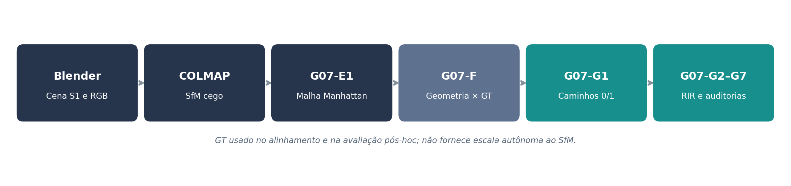

*Figura 1 — Fluxo efetivamente percorrido de Blender/RGB até as auditorias geométricas e acústicas. A separação entre reconstrução cega e validação informada por GT é essencial.*

---

## 1. Questão de pesquisa e objetivos

**Questão central:** de que maneira a perda de superfícies arquitetônicas durante a reconstrução tridimensional a partir de imagens RGB altera a previsão de visibilidade sonora, reflexões e respostas impulsionais em ambientes não convexos?

O experimento busca: (i) identificar superfícies com baixa cobertura SfM; (ii) medir o efeito de imagens adicionais dirigidas; (iii) recuperar uma malha fechada a partir de COLMAP sem fornecer diretamente a planta GT ao reconstrutor; (iv) quantificar discrepâncias geométricas depois de um alinhamento reservado à avaliação; (v) comparar trajetórias e RIR sob configurações acústicas idênticas; e (vi) investigar casos em que a métrica acústica diverge apesar da boa correspondência geométrica.

A campanha **não** mede a capacidade de inferir escala métrica absoluta sem referência e **não** testa ainda generalização em recintos reais. Estas questões ficam para os estudos seguintes.

## 2. Cenário S1 e desenho experimental

A planta GT é o polígono, em metros,

```text
(0,0) → (6,0) → (6,5) → (3.8,5) → (3.8,4.3)
      → (2.2,4.3) → (2.2,5) → (0,5) → fechamento
```

| Propriedade GT | Valor |
|---|---:|
| Dimensão externa em planta | 6,0 × 5,0 m |
| Profundidade do rebaixo | 0,7 m |
| Largura do rebaixo | 1,6 m |
| Altura | 3,0 m |
| Área útil da planta | 28,88 m² |
| Volume | 86,64 m³ |
| Segmentos de parede | 8 |
| Esquinas côncavas | 2 |
| Superfícies semânticas (paredes + piso + teto) | 10 |

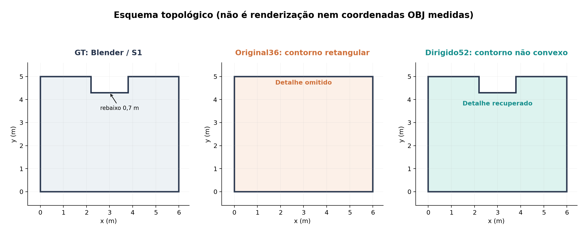

*Figura 2 — Representação **esquemática** da topologia: planta GT, contorno retangular obtido com Original36 e topologia não convexa recuperada com Dirigido52. As dimensões do desenho derivam do GT e não substituem os arquivos OBJ alinhados.*

As **36 imagens RGB originais**, com resolução de **960 × 720 px**, foram renderizadas no Blender e processadas pelo COLMAP. Uma auditoria de cobertura identificou escassez de pontos sobre `wall_03` e `wall_05`, as faces laterais curtas do rebaixo. Adicionaram-se **16 imagens** dirigidas a essas paredes, formando um conjunto de **52 imagens** que preservou as 36 anteriores.

Os dois modelos SfM foram construídos a partir de **RGB**. Na comparação geométrica, a Sim3 foi ajustada com **18 centros de câmera das imagens originais** e aferida com outras **18 câmeras originais reservadas**. As coordenadas GT foram empregadas **depois**, para avaliação e colocação controlada das geometrias na mesma escala acústica. Isso impede afirmar que se recuperou escala física autonomamente.

## 3. Recuperação visual e geométrica — G07-D4, E1 e F

### 3.1. Desempenho SfM e cobertura superficial

| Indicador | Original36 | Dirigido52 |
|---|---:|---:|
| Câmeras registradas | 36/36 | 52/52 |
| Pontos SfM brutos | 13.865 | 18.736 |
| Pontos aprovados nos filtros de qualidade | 13.044 | 17.039 |
| `wall_03`: células cobertas (20 cm) | **5,0%** | **75,0%** |
| `wall_05`: células cobertas (20 cm) | **13,3%** | **71,7%** |
| Erro médio dos 18 centros de câmera reservados | 1,214 mm | 1,519 mm |

O erro médio de posição das câmeras reservadas **aumentou ligeiramente** na aquisição ampliada; a melhoria mais importante ocorreu na **observabilidade das paredes**. O ganho em cobertura foi de **70,0 pontos percentuais** em `wall_03` e **58,3 pontos percentuais** em `wall_05`.

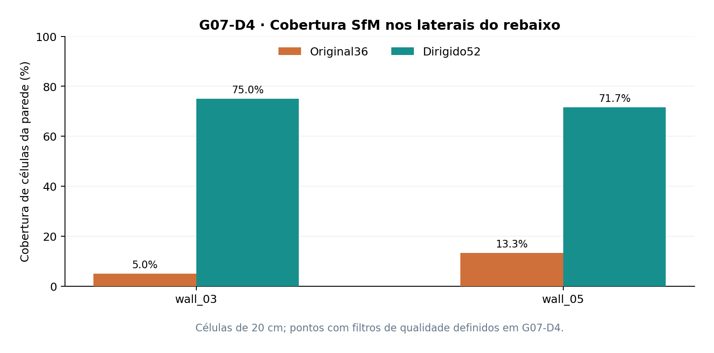

*Figura 3 — Cobertura por células das duas paredes laterais críticas, usando os filtros de reprojeção e multiplicidade de observações empregados no G07-D4.*

### 3.2. Reconstrução e avaliação da malha

A etapa G07-E1 identificou planos e construiu candidatos de malha a partir da saída esparsa do COLMAP. O modelo de 36 imagens resultou em uma **caixa de quatro paredes**, sem esquinas côncavas. O modelo de 52 imagens recuperou a estrutura de **oito paredes e duas esquinas côncavas**. Ambos receberam `PASS_EXPLORATORY`, porque a condição verificava a consistência do contorno reconstruído — **não** sua correspondência com a arquitetura verdadeira.

O G07-F realizou a verificação pós-hoc:

| Métrica G07-F | Original36 | Dirigido52 |
|---|---:|---:|
| Segmentos de parede na malha | 4 | **8** |
| Esquinas côncavas | 0 | **2** |
| IoU exata em planta | 0,961905 | **0,999609** |
| Erro de volume | +3,9956% | **−0,0343%** |
| GT → OBJ: distância média | 33,422 mm | **0,566 mm** |
| GT → OBJ: distância P95 | 299,933 mm | **1,134 mm** |
| OBJ → GT: distância P95 | 2,691 mm | **1,087 mm** |
| Critérios GT provisórios | Reprovou | **Aprovou** |

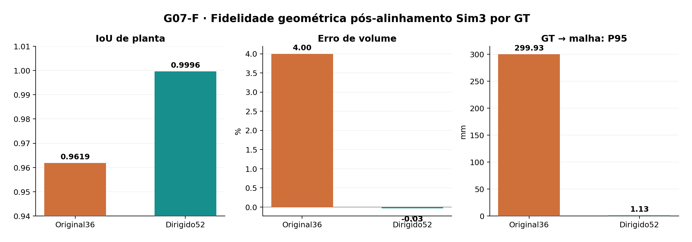

*Figura 4 — Comparação entre os dois candidatos. IoU é calculada sobre polígonos em planta; distâncias de superfícies são estimadas por amostragem finita, com passo de 0,15 m no G07-F.*

A discrepância está concentrada no rebaixo: os erros médios da `wall_03`, `wall_04` e `wall_05` eram, respectivamente, **276,27, 510,39 e 276,52 mm** no Original36; passaram a **1,10, 0,49 e 1,06 mm** no Dirigido52.

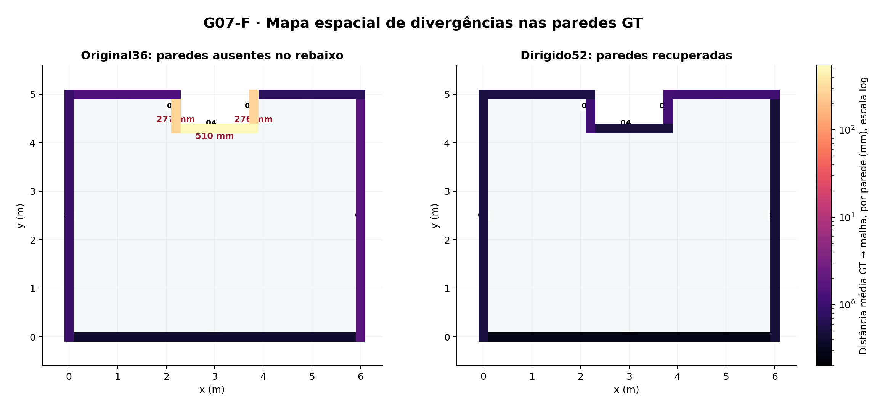

*Figura 5 — **Mapa de calor das zonas divergentes**, colorindo cada segmento real de parede pelo erro médio dirigido GT → OBJ, em escala logarítmica. As cores não são uma malha de erro ponto a ponto: os valores são agregados por parede, conforme `g07f_wall_errors.csv`.*

A assimetria entre GT → OBJ e OBJ → GT é relevante. Uma reconstrução retangular pode ter pequenas distâncias de suas superfícies ao GT e, ainda assim, **omitir** paredes reais. A análise bidirecional e a verificação topológica são, portanto, necessárias.

## 4. Propagação geométrica de caminhos acústicos — G07-G1

Foram selecionadas **três fontes e 29 receptores**, totalizando **87 pares fonte–receptor**. Um avaliador analítico calculou propagação direta e reflexões especulares de primeira ordem sobre paredes finitas, piso e teto, com checagem de visibilidade no polígono não convexo.

| Indicador | Original36 | Dirigido52 |
|---|---:|---:|
| Caminhos diretos falsos | **8** | **0** |
| Caminhos diretos verdadeiros perdidos | 0 | 0 |
| Reflexões GT de primeira ordem | 434 | 434 |
| Reflexões candidatas | 522 | 432 |
| Reflexões corretamente emparelhadas | 417 | **432** |
| Reflexões GT omitidas | 17 | **2** |
| Reflexões espúrias | 105 | **0** |
| Recall de reflexões | 96,083% | **99,539%** |
| Precisão de reflexões | 79,885% | **100%** |
| Erro P95 no tempo de chegada, reflexões emparelhadas | 11,017 µs | **4,939 µs** |

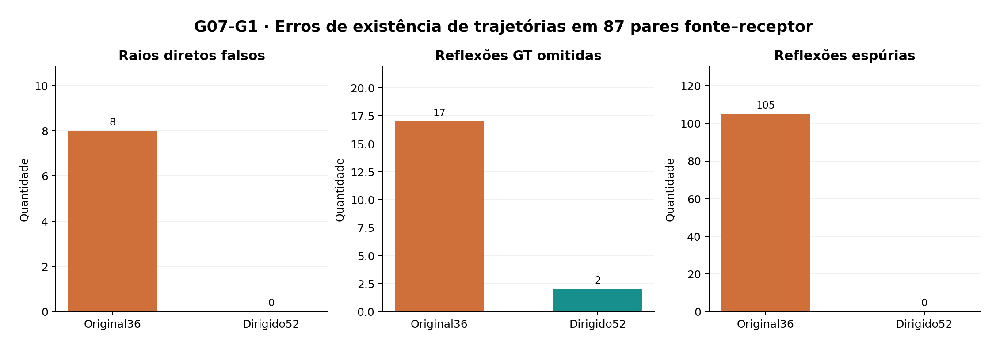

*Figura 6 — Consequências acústicas diretas da omissão do rebaixo. Os erros de tempo e de posição não incluem trajetórias sem correspondência; por isso, os contadores de falsos positivos e falsos negativos são indispensáveis.*

**Interpretação:** o modelo Original36 apresentou uma IoU de planta acima de 96%, mas falhou em regiões onde a nova parede altera a oclusão e o conjunto de reflexões possíveis. Portanto, métricas geométricas globais isoladas podem ser inadequadas para predizer a qualidade acústica.

## 5. Comparação de respostas impulsionais — G07-G2/G3

### 5.1. Configuração controlada

O mesmo mecanismo poligonal do **Pyroomacoustics 0.10.1** foi aplicado às três geometrias: **GT, Original36 e Dirigido52**, com **48 kHz**, velocidade do som de **343 m/s**, absorção energética sintética uniforme de **0,2**, sem *scattering*, difração, traçado de raios ou diretividade. As RIR foram avaliadas para ordens máximas ISM **0, 1, 2 e 3**, ou seja, cada RIR de ordem N acumula contribuições de 0 até N.

O código utilizou uma proteção local para normalizar máscaras de visibilidade. Entretanto, a execução registrada forneceu máscaras originalmente do tipo **`bool`**. Esses dados **não demonstram um defeito `int32` da instalação** nem justificam atribuir o resultado a erro do simulador.

No **ISM de ordem 0**, o GT é silencioso para oito casos sem linha de visão. O Original36 gerou sinal nesses oito casos, enquanto o Dirigido52 não gerou nenhum. A mediana de erro quase zero dos demais casos de ordem 0 **não inclui** essas referências silenciosas; por isso, não representa ausência de falhas.

### 5.2. Energia

| Ordem máxima | Erro absoluto médio — 36 | Erro absoluto médio — 52 | Erro P95 — 36 | Erro P95 — 52 |
|---:|---:|---:|---:|---:|
| 1 | 1,5256 dB | **0,0272 dB** | 10,5129 dB | **0,0973 dB** |
| 2 | 1,3387 dB | **0,0510 dB** | 7,1131 dB | **0,1231 dB** |
| 3 | 1,1374 dB | **0,0707 dB** | 5,7493 dB | **0,1913 dB** |

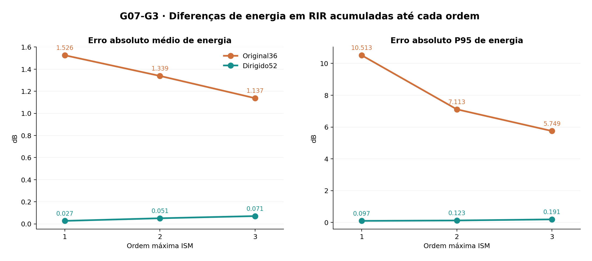

*Figura 7 — Erro energético médio e percentil 95 das RIR. Cada ordem constitui uma simulação acumulada, não uma contagem isolada da energia daquela ordem.*

A melhora média relativa do erro absoluto de energia foi de **98,2%, 96,2% e 93,8%**, respectivamente para ordens 1, 2 e 3. Essas porcentagens se referem **a uma redução de erro**, não a um aumento de desempenho medido fisicamente na sala.

### 5.3. Forma de onda e envoltória energética

| Ordem máxima | RIR L2 médio — 36 | RIR L2 médio — 52 | Envoltória L2 média — 36 | Envoltória L2 média — 52 |
|---:|---:|---:|---:|---:|
| 1 | 0,8080 | **0,1549** | 1,5751 | **0,0202** |
| 2 | 0,8058 | **0,2157** | 0,9834 | **0,0344** |
| 3 | 0,8478 | **0,2675** | 0,6914 | **0,0455** |

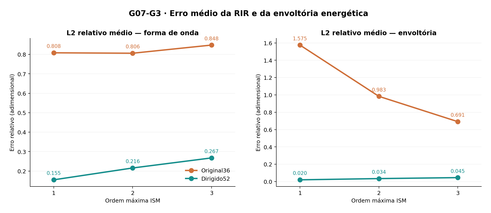

*Figura 8 — A reconstrução Dirigido52 permanece melhor, mas seu erro cresce conforme entram novas reflexões. O erro relativo da forma de onda também é sensível à discretização temporal e a atrasos fracionários.*

A média global não implica que cada receptor tenha melhorado em todas as métricas. A auditoria pareada G07-G4 encontrou melhora de **RIR L2 em 87/87 casos** para cada ordem de 1 a 3; porém, o erro energético piorou em **13, 10 e 12 casos**, respectivamente. Todos esses resultados devem ser mantidos, sem seleção seletiva de receptores.

## 6. Auditoria do receptor singular — G07-G4/G5/G6

### 6.1. Localização

O caso extremo concentra-se em `S_center=(3,0; 2,0; 1,5) m` e `R_grid_2_0=(3,0; 0,8; 1,5) m`. Fonte e receptor compartilham **x=3 m** e **z=1,5 m**, configuração particularmente simétrica.

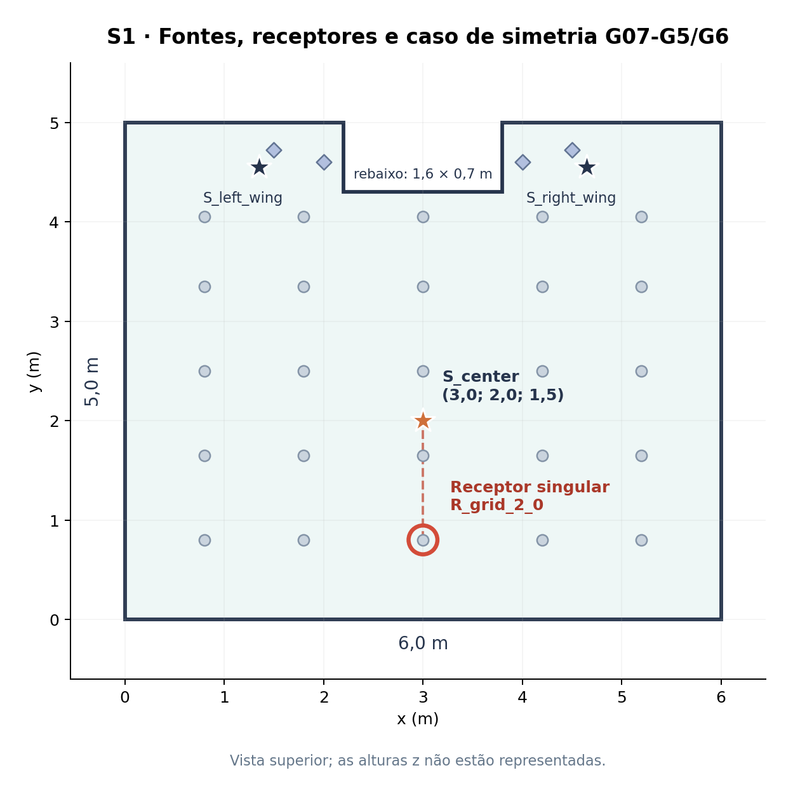

*Figura 9 — Vista superior de S1; os 25 pontos da grade e quatro receptores adicionais compõem 29 microfones. A posição crítica está destacada em vermelho.*

No ponto central, o erro absoluto de energia Dirigido52 foi **1,3298 dB** (ordem 2) e **1,6192 dB** (ordem 3), os máximos relevantes de G07-G4. As **nove** verificações de reprodução G07-G5 coincidiram exatamente com os arquivos NPZ anteriores (`L2 relativo = 0`).

### 6.2. Sensibilidade milimétrica no GT

| ISM acumulado | Fontes imagem visíveis: receptor central | Após X ±5 mm | Após Z ±5 mm |
|---:|---:|---:|---:|
| 2 | 29 | 25 | 25 |
| 3 | 71 | 61 | 61 |

Para a geometria **GT** em ISM até ordem 3, deslocar o receptor em **X ±5 mm** reduziu a energia aproximadamente **2,673 dB**; em **Z ±5 mm**, aproximadamente **2,842 dB**. Também se alterou a forma da RIR. Esses efeitos aparecem na referência GT e não podem ser explicados **somente** pelos erros da reconstrução.

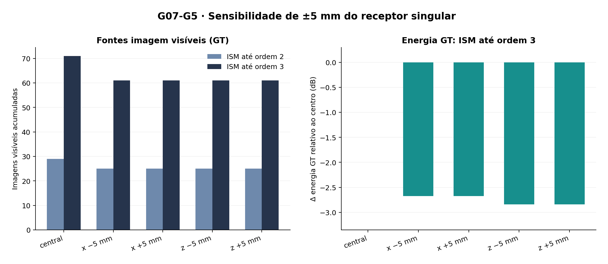

*Figura 10 — Na posição geométrica central há fontes imagem adicionais consideradas visíveis. O deslocamento de poucos milímetros muda essa classificação e a energia calculada.*

### 6.3. Reflexões incidentes em arestas

A auditoria G07-G6 localizou fontes imagem de segunda ordem com impactos sobre as junções **parede–piso** e **parede–teto**. Por exemplo, uma fonte imagem em torno de **(9; 2; −1,5) m** gera incidência em **(6; 1,4; 0) m**, exatamente sobre a aresta comum à parede `x=6` e ao piso `z=0`.

Na avaliação até ordem 2, **oito registros** presentes na posição central e ausentes em alguma perturbação apresentaram indícios de contato com arista, com cadeias candidatas recuperáveis. Até ordem 3, **22 registros** foram sinalizados; **sete cadeias ancestrais não puderam ser recuperadas** integralmente. As histórias de reflexão reconstruídas por coincidência de posições-espelho permanecem **hipóteses geométricas** quando não há evidência independente de toda a sequência.

Uma incidência exatamente sobre uma aresta é singular para o modelo ideal de reflexão especular planar. O achado **não é prova de falha geral da implementação de Pyroomacoustics** e tampouco estabelece que todas as contribuições de borda sejam fisicamente válidas.

## 7. Robustez local — G07-G7

As perturbações de ±5/±10 mm foram analisadas separando deslocamentos **X/Z** (oito casos) e **Y** (quatro casos), sempre mantendo a posição central no benchmark principal.

| ISM até ordem 3 | Original36 | Dirigido52 | Casos em que 52 melhorou |
|---|---:|---:|---:|
| X/Z: erro absoluto médio de energia | 0,1259 dB | **0,1047 dB** | 5/8 |
| X/Z: RIR L2 médio | 0,5677 | **0,1653** | 8/8 |
| X/Z: envoltória L2 média | 0,1215 | **0,0366** | 8/8 |
| Y: erro absoluto médio de energia | **1,6618 dB** | 1,6763 dB | 1/4 |
| Y: RIR L2 médio | 0,6687 | **0,3506** | 4/4 |

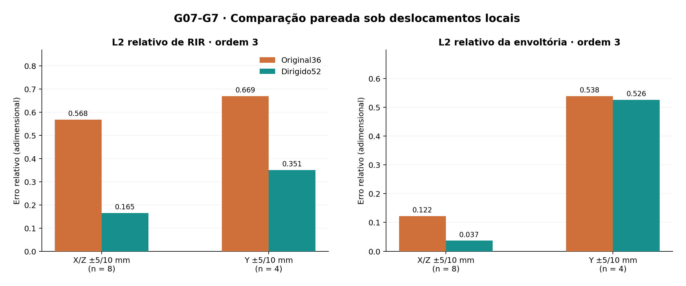

*Figura 11 — A configuração Dirigido52 reduz erros de forma de onda e envoltória em todos os deslocamentos registrados, mas a energia não melhora uniformemente, especialmente no eixo Y.*

A análise é **exploratória e posterior à descoberta do caso extremo**. As 12 posições deslocadas não representam 12 amostras espaciais independentes e não devem substituir os 87 pares originais por uma seleção mais favorável.

## 8. Discussão integrada

A sequência experimental apresenta **evidências compatíveis com a hipótese** de que vistas orientadas para superfícies pouco observadas podem permitir a recuperação de detalhes arquitetônicos importantes para a simulação acústica. A comparação Original36 × Dirigido52, isoladamente, não identifica o efeito causal específico da orientação. O efeito foi observado em diferentes níveis: cobertura SfM (`wall_03`/`wall_05`), topologia da malha (4 vs 8 paredes), correspondência geométrica (IoU e distância GT → OBJ), caminhos válidos (oclusão e reflexões) e RIR até a terceira ordem.

O resultado também evidencia que uma elevada IoU não basta para caracterizar a aptidão acústica da geometria: uma simplificação pequena em área pode eliminar faces que definem novas reflexões ou bloqueiam caminhos diretos. Por outro lado, um bom erro geométrico global não impede singularidades numéricas ou idealizações físicas nas proximidades de arestas.

Há pelo menos **três fenômenos distintos**: (a) perda real de superfície pelo processo RGB/SfM; (b) diferenças pequenas de posição e orientação das faces recuperadas; e (c) condições geométricas degeneradas do modelo especular no GT. Uma avaliação bem delimitada deve distinguir os três, em vez de atribuir todo desvio energético ao reconstrutor.

### Validade interna e externa

**Validade interna:** os modelos foram comparados com mesmas fontes, receptores, parâmetros acústicos e escala comum de avaliação. As RIR do caso singular foram reproduzidas numericamente a partir dos NPZ. A aquisição de 52 imagens, entretanto, acrescentou simultaneamente **quantidade de fotos e orientação direcionada**; por isso, o efeito específico da orientação exige o controle H1.

**Validade externa:** há apenas **um recinto sintético S1**; a aparência RGB é sintética, as superfícies obedecem a uma estrutura Manhattan de altura constante, e não houve medidas de RIR, RT60 ou STI em salas reais. Não é possível extrapolar erros milimétricos nem ganhos percentuais a outros ambientes sem novas avaliações.

## 9. Próximo controle G07-H1 — planejado, não executado

O experimento de controle H1 foi preparado para manter **36 fotografias originais idênticas** e colocar as **16 câmeras adicionais nas mesmas posições** em ambas as aquisições de 52 imagens. Apenas as direções de captura serão alteradas: **visadas gerais para a sala** versus **visadas dirigidas para o rebaixo**.

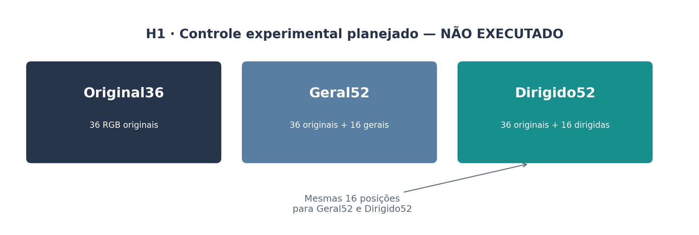

*Figura 12 — **Projeto experimental futuro.** Esta figura ilustra grupos que serão comparados; não representa métricas nem resultados já observados de General52.*

A variável principal esperada é a cobertura de `wall_03` e `wall_05`, seguida da recuperação topológica e da avaliação acústica. Se as duas estratégias com 52 imagens alcançarem coberturas comparáveis, parte do ganho poderá ser atribuída às posições adicionais, e não especificamente à direção das câmeras.

Após H1, recomenda-se: **(1)** recuperar a escala por uma referência física independente de GT; **(2)** executar diferentes sementes/aquisições; **(3)** estender a reconstrução a recintos **S2 (forma de L)** e **S3 (paredes oblíquas)**, ultrapassando a hipótese Manhattan; e **(4)** incorporar dados acústicos externos, materiais conhecidos e, se pertinente, diretividade de fontes, com validações apropriadas antes de inferir indicadores reverberantes de alta ordem.

## 10. Conclusões

1. **Cobertura:** 16 imagens dirigidas elevaram a cobertura das faces críticas de 5,0%/13,3% para 75,0%/71,7% no cenário S1.
2. **Topologia:** a aquisição Original36 produziu uma caixa sem rebaixo; Dirigido52 recuperou oito paredes e duas esquinas côncavas.
3. **Fidelidade geométrica:** com a escala e orientação ajustadas por GT apenas durante a avaliação, a IoU passou a 0,99961 e a distância GT → OBJ P95 ficou em 1,13 mm.
4. **Caminhos acústicos:** o contorno retangular introduziu oito trajetórias diretas falsas e 105 reflexões espúrias de ordem 1; ambos os contadores chegaram a zero com a topologia recuperada.
5. **RIR:** o erro médio de energia e o erro L2 das RIR foram menores no Dirigido52 em todas as ordens ISM 1–3, mas a métrica energética piorou em uma minoria de pares fonte–receptor.
6. **Singularidade:** um hotspot com reflexão exatamente sobre arestas provocou mudanças abruptas de visibilidade e energia já na geometria GT, exigindo auditoria separada e manutenção do caso original na comparação.
7. **Próximo passo:** completar G07-H1 e a calibração de escala independente antes de transformar o resultado exploratório de S1 numa alegação geral de reconstrução acústica autônoma.

**Síntese:** a qualidade de uma reconstrução arquitetônica para fins acústicos deve ser avaliada **também pelo efeito da geometria sobre o modelo de propagação**, não apenas por métricas de forma, área, volume ou distância superficial.

---

## Apêndice A — Equações e convenções

**IoU em planta:** `IoU = Área(P_GT ∩ P_REC) / Área(P_GT ∪ P_REC)`.  
**Erro relativo de volume:** `100 × (V_REC − V_GT) / V_GT`.  
**Erro absoluto de energia (dB):** `|10 log10(E_REC / E_GT)|` somente quando ambas as energias são positivas; referência silenciosa é avaliada separadamente como sinal espúrio/ausente.  
**Erro relativo de forma de onda:** `||h_REC − h_GT||₂ / ||h_GT||₂`, para casos comparáveis, com mesmos parâmetros de discretização.  
**P95:** percentil 95 dentro do conjunto de pontos/casos especificado, sem interpretar a amostra espacial correlacionada como replicação independente.  
**ISM até ordem N:** conjunto acumulado de reflexões de ordens 0 a N.  
**GT → OBJ / OBJ → GT:** distâncias direcionais: não se deve trocar uma pela outra.  
**Erro em micrômetros ou milímetros:** a precisão numérica reportada não equivale automaticamente à precisão de uma aquisição física.

## Apêndice B — Fontes internas e rastreabilidade

As métricas foram consolidadas **a partir das saídas executadas pelo pesquisador**, não de uma nova rodada do simulador ao elaborar este documento. A evidência original acompanha o ZIP na pasta `evidencias/`, organizada pelos identificadores dos experimentos. Também foram usados os relatórios Markdown preliminares já preparados durante a campanha.

| Experimento | Artefato de execução e finalidade |
|---|---|
| G07-D4 | `g07d4_paired_summary.json` (saída local do projeto), cobertura e alinhamento pareado |
| G07-E1 | `evidencias/G07-E1_saida_terminal.txt`, candidatos de malha e topologia |
| G07-F | Dados de execução informados na conversa; referência local `validation_f_v2/g07f_report.md` |
| G07-G1 | `evidencias/G07-G1_saida_terminal.txt`, caminhos e visibilidade |
| G07-G2 | `evidencias/G07-G2_saida_terminal.txt`, RIR de ordens 0 e 1 |
| G07-G3 | `evidencias/G07-G3_saida_terminal.txt`, RIR de ordens 0 a 3 |
| G07-G4 | `evidencias/G07-G4_saida_terminal.txt`, auditoria pareada por receptor |
| G07-G5 | `evidencias/G07-G5_resumo_terminal.txt` e `evidencias/G07-G5_tabelas_terminal.txt`, estabilidade |
| G07-G6 | `evidencias/G07-G6_saida_terminal.txt`, incidências sobre arestas |
| G07-G7 | `evidencias/G07-G7_saida_terminal.txt`, robustez pareada |
| G07-H1 | Somente projeto metodológico; **nenhum resultado observado** |

**Reprodução das figuras:** no diretório do relatório, execute `python3 gerar_figuras.py` após instalar `matplotlib` e `numpy`. As imagens permanecem em `figuras/`, referenciadas por caminhos relativos compatíveis com visualizadores Markdown e GitHub.
