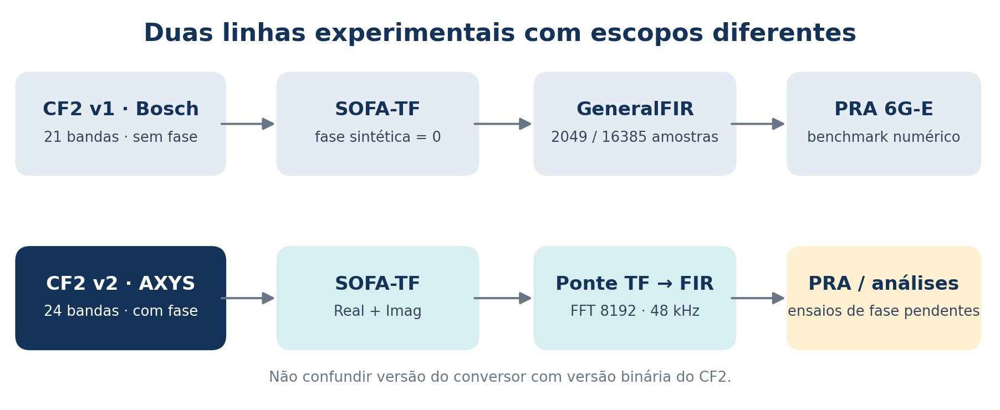
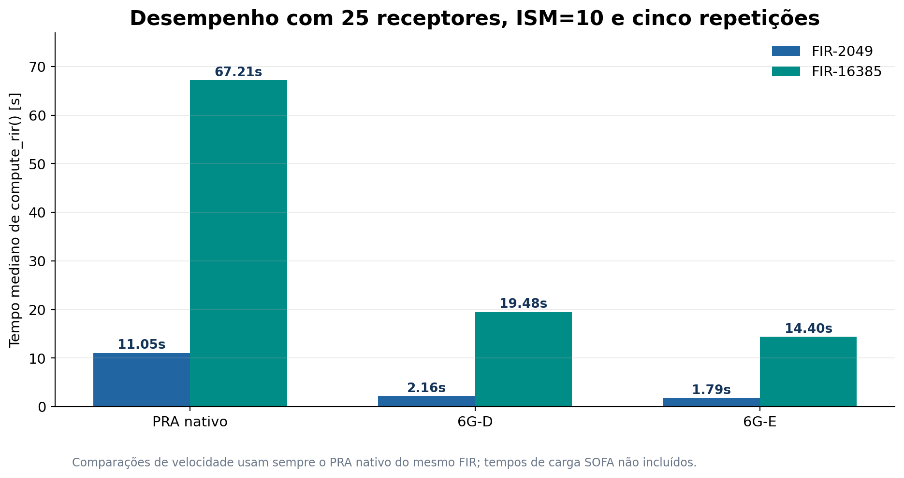
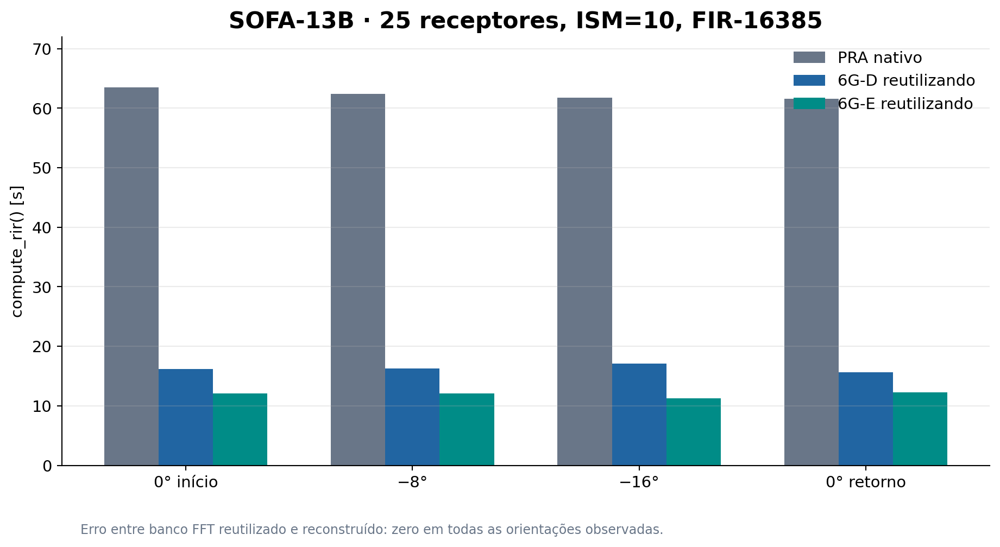
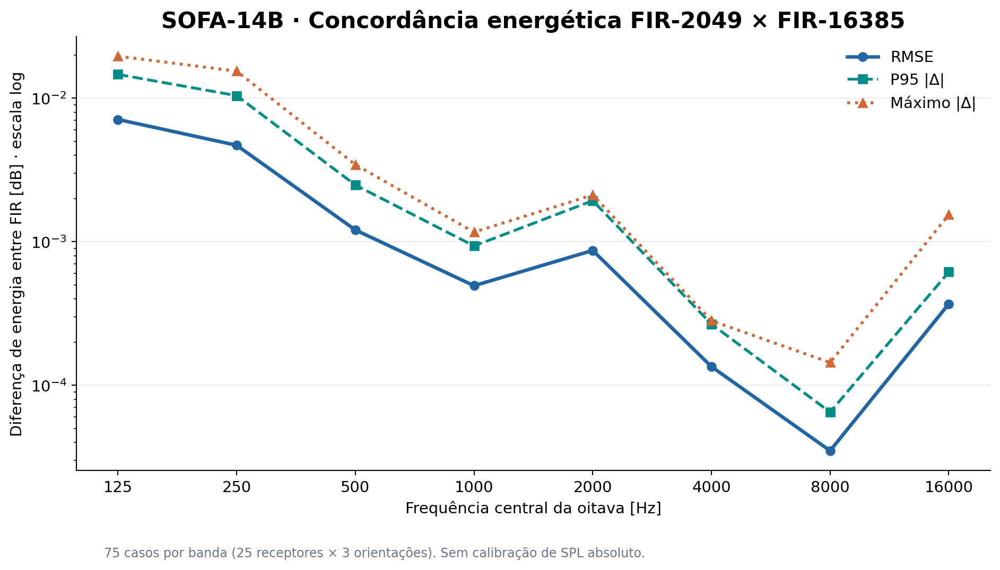
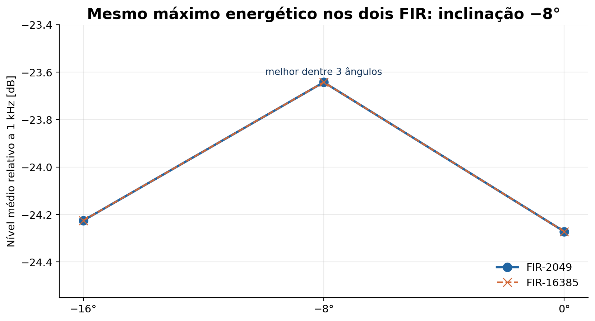
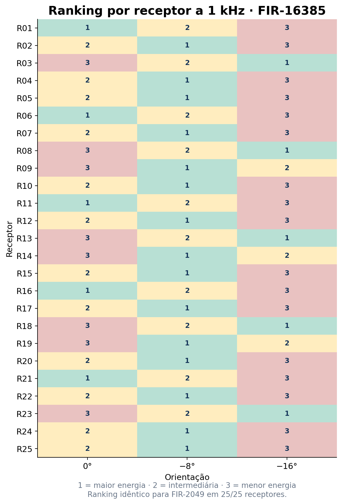
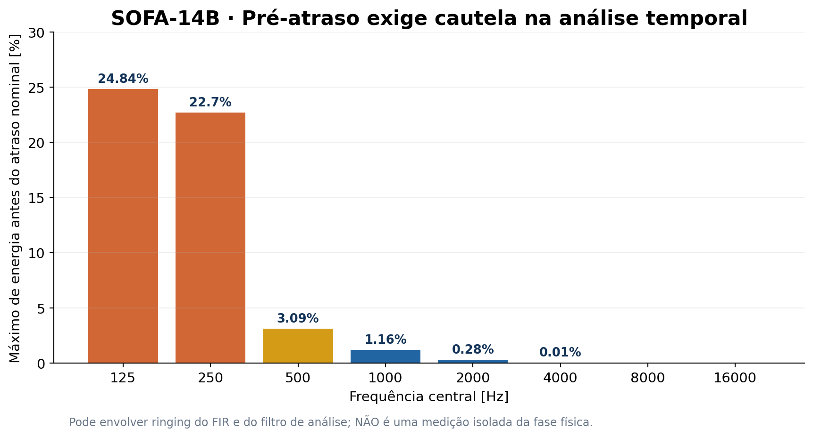
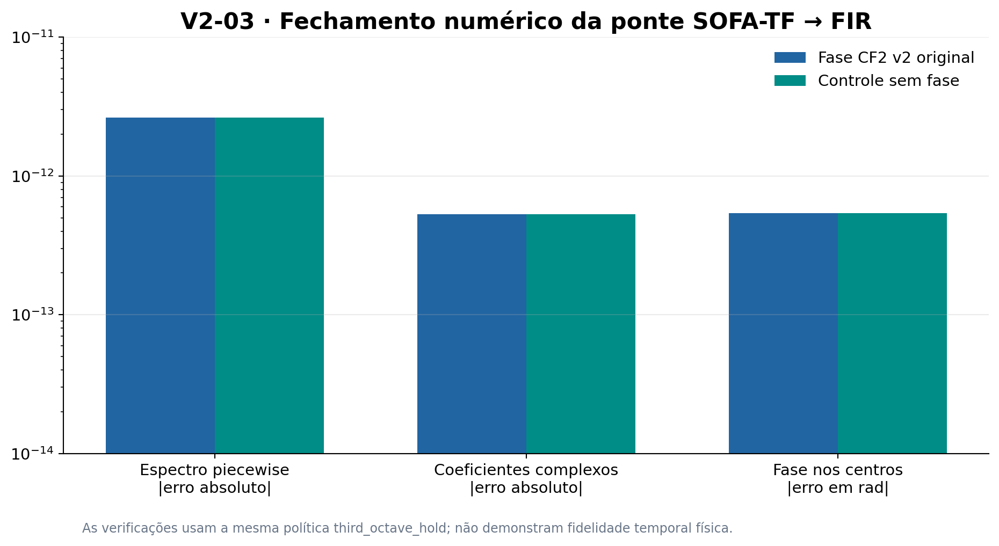
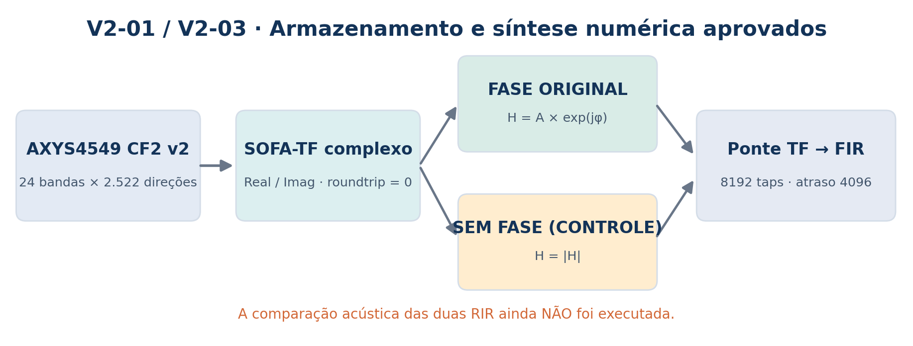

# Relatório técnico — CF2 v1/v2, SOFA, preservação de fase e benchmarks acústicos

**Data de consolidação:** 23 de outubro de 2026  
**Escopo:** atividades e resultados registrados até a execução do *Experiment 6B* do AXYS4549 (FIR de 8.192 amostras).  
**Ambiente principal:** Ubuntu, Python em ambiente virtual, Pyroomacoustics 0.10.1, 48 kHz nos ensaios SOFA recentes.  
**Estado geral:** conversões e verificações numéricas reportadas como **PASS**; avaliação acústica comparativa com/sem fase **ainda não realizada**.

> **Resumo executivo.** Os ensaios com o Bosch LA1-UW24 (CF2 binário v1) demonstraram aceleração computacional, concordância entre implementações e sensibilidade à orientação, mas partiram de **magnitudes com fase sintética**, porque a origem v1 não continha fase medida. Ao recuperar o AXYS4549 (CF2 v2), validamos uma cadeia distinta: **CF2 v2 com fase → representação canônica → SOFA-TF complexo → FIR de 8.192 amostras**. As duas variantes, **fase original** e **controle sem fase**, passaram na ponte TF→FIR com erro numérico na ordem de 10⁻¹² a 10⁻¹³. Isso **não** significa que o efeito da fase na acústica da sala tenha sido medido: essa comparação é o próximo experimento.



*Figura 1 — Separação das duas cadeias experimentais. O número v2 presente no nome de um conversor não transforma um arquivo CF2 v1 em CF2 v2.*

## 1. Questão de pesquisa e objetivos

**Questão central:** a incorporação da fase disponível em arquivos CF2 v2 altera as respostas impulsivas, os indicadores acústicos ou a seleção de orientações quando a magnitude, o emissor, a sala e o método de síntese são mantidos constantes?

Objetivos específicos:

1. Rastrear a versão binária e a presença real de fase em cada CF2.
2. Preservar as amostras de **magnitude e fase** do CF2 v2 em SOFA `FreeFieldDirectivityTF`.
3. Validar a passagem do espectro complexo para um FIR utilizável no Pyroomacoustics.
4. Construir um **controle sem fase para o mesmo AXYS4549**; não confundir efeito da fase com troca de alto-falante.
5. Reaplicar benchmarks **NATIVE × 6G-D/E** com FIR de fase não trivial, e avaliar energia, estrutura temporal e ranking de orientações.
6. Documentar limitações antes de comparar resultados com I-Simpa, SPPS, ODEON ou medições físicas.

## 2. Inventário dos arquivos CF2 e a diferença entre v1 e v2

O inventário executado sobre 897 **caminhos de arquivos** encontrou:

| Indicador | Resultado |
|:--|--:|
| Arquivos/caminhos examinados | 897 |
| CF2 binário v1 | 833 |
| CF2 binário v2 | 64 |
| CF2 v2 com contêiner de fase | 64 |
| Falhas de leitura | 0 |

**Atenção:** o inventário apresentou cópias repetidas dos mesmos modelos em diretórios distintos. Assim, **64 é número de arquivos/caminhos classificados como v2, não de 64 modelos diferentes**. Possuir contêiner de fase também não basta, por si só, para afirmar a qualidade física dessas fases.

| Propriedade | Bosch LA1-UW24 | AXYS4549 |
|:--|:--|:--|
| Formato de origem | CF2 v1 | CF2 v2 |
| Frequências declaradas | 21; 100–10.000 Hz | 24; 100–20.000 Hz |
| Grade original | 72 × 37 = 2.664 | 72 × 37 = 2.664 |
| Fase presente no arquivo | **Não** | **Sim** |
| Estratégia SOFA-TF | fase nula sintética | magnitude e fase CF2 originais |
| Uso científico | baseline de magnitude e desempenho | baseline complexo e ensaio de sensibilidade à fase |

O algoritmo `cf2_parser_v5.py` foi usado para leitura binária; `experiment5g_canonical_complex2522.py` criou as direções canônicas, enquanto `experiment6a_write_freefielddirectivitytf_v2.py` escreveu o SOFA-TF. O sufixo `v2` desse último nome designa uma versão do **programa**, e não a versão binária de qualquer CF2 lido por ele.

## 3. Histórico resumido: o que foi demonstrado com Bosch CF2 v1

### 3.1 Representações SOFA criadas

O Bosch foi convertido em `FreeFieldDirectivityTF` com **fase sintética igual a zero**; subsequentemente foram criados `GeneralFIR` de 2.049 e 16.385 amostras, com fase linear **sintética** e atrasos de, respectivamente, 1.024 e 8.192 amostras. As 2.664 direções armazenadas no domínio angular foram tratadas como **2.522 únicas**, com 142 duplicatas polares idênticas para o arquivo utilizado.

A concordância numérica do FIR com o TF de origem foi avaliada previamente. Erros espectrais máximos reportados: **0,349 dB** para FIR-2049 e **0,0405 dB** para FIR-16385. Não se trata de fase física recuperada.

### 3.2 Desempenho com 25 receptores, ISM ordem 10

| FIR | Método | Mediana `compute_rir()` | Repetições | Aceleração perante nativo do mesmo FIR |
|:--|:--|--:|--:|--:|
| 2.049 | NATIVE | 11,051107 s | 5 | 1,000× |
| 2.049 | 6G-D | 2,162038 s | 5 | 5,111× |
| 2.049 | 6G-E | **1,785836 s** | 5 | **6,188×** |
| 16.385 | NATIVE | 67,205981 s | 5 | 1,000× |
| 16.385 | 6G-D | 19,481772 s | 5 | 3,450× |
| 16.385 | 6G-E | **14,400879 s** | 5 | **4,667×** |

Os tempos se referem ao cálculo `compute_rir()`, sem contabilizar todo o carregamento do SOFA. A montagem da cache foi medida separadamente. Houve aquecimento anterior às cinco repetições; a execução em blocos por método exige cuidado com variação térmica/carga do computador.



*Figura 2 — Medianas observadas em SOFA-05 e SOFA-11. O FIR mais curto foi mais rápido; esse gráfico não compara fase real vs. fase zero.*

O teste prévio de **CF2 escalar versus CF2 vetorizado** registrou aceleração de aproximadamente **44,01×** para um mecanismo de cálculo **diferente** do caminho SOFA-6G-E. Não somar nem comparar essas acelerações diretamente como se fossem o mesmo algoritmo.

### 3.3 Reutilização do banco FFT de diretividade (SOFA-13B)

A sequência `0° → −8° → −16° → 0°` foi executada com **25 receptores, ISM=10, FIR-16385**. Nas quatro orientações, para 6G-D e 6G-E, o banco reutilizado e o banco reconstruído apresentaram **diferença máxima de RIR registrada igual a zero**. Erros relativos perante o motor nativo de 6G-E: aproximadamente `1,11×10⁻⁷` a `1,32×10⁻⁷`.



*Figura 3 — Teste de reutilização por orientação. A cache de atraso fracionário do método E não foi reconstruída de maneira totalmente independente entre as duas vias do teste; a conclusão estrita abrange o banco FFT de diretividade.*

### 3.4 Fidelidade entre FIR curto e longo (SOFA-14B)

Com **25 receptores, três inclinações (0°, −8°, −16°) e ISM=10**, o teste reportou **75 casos por banda**, comparação após alinhamento dos atrasos sintéticos e os seguintes erros energéticos:

| Banda | RMSE [dB] | P95 abs. [dB] | Máximo abs. [dB] |
|:--|--:|--:|--:|
| Banda larga | 0,004343 | 0,006896 | 0,007256 |
| 125 Hz | 0,007110 | 0,014649 | **0,019611** |
| 250 Hz | 0,004700 | 0,010422 | 0,015436 |
| 500 Hz | 0,001209 | 0,002486 | 0,003447 |
| 1.000 Hz | 0,000494 | 0,000935 | 0,001167 |
| 2.000 Hz | 0,000870 | 0,001933 | 0,002119 |
| 4.000 Hz | 0,000135 | 0,000267 | 0,000282 |
| 8.000 Hz | 0,000035 | 0,000065 | 0,000144 |
| 16.000 Hz | 0,000369 | 0,000616 | 0,001544 |



*Figura 4 — Diferenças das representações FIR de **mesma origem v1**; não são erros com respeito a um sistema medido nem à fase física do equipamento.*

O ranking **completo** das três inclinações em 1 kHz coincidiu em **25/25 receptores**. O critério de nível médio escolheu **−8°** entre as três alternativas na geometria de ISM=10, mas a dispersão espacial também mudou com a inclinação (em torno de **1,79, 2,49 e 3,06 dB** para 0°, −8° e −16°). Assim, maximizar o nível não equivale a otimizar uniformidade, inteligibilidade ou percepção.



*Figura 5 — Médias relativas em 1 kHz. As duas curvas quase se sobrepõem.*



*Figura 6 — Em cada receptor, posição relativa de cada orientação no ranking de energia a 1 kHz. Foi observado o mesmo ranking nos dois FIR.*

As diferenças **exploratórias** em 125 Hz foram: RMSE de C50 = **0,02221 dB**, C80 = **0,01522 dB** e D50 = **0,04284 ponto percentual**. Entretanto, foi detectada energia anterior ao atraso nominal até **24,84% em 125 Hz** e **22,70% em 250 Hz** para FIR-16385 no processamento aplicado. Esse indicador pode incorporar ringing da síntese e do filtro de análise; não deve ser apresentado como pré-ringing físico medido.



*Figura 7 — Diagnóstico que exige cautela antes de interpretar métricas temporais do modelo sintético.*

**Interpretação:** o histórico Bosch validou a qualidade **computacional** e a proximidade energética de duas aproximações. Ele não comprova fidelidade de fase, porque o CF2 v1 não fornece tal informação.

## 4. AXYS4549 CF2 v2 — Inventário e inspeção da fase

A auditoria do arquivo AXYS4549 constatou:

- Contêiner de fase presente; versão binária **2**.
- Frequências declaradas: **24** de **100 a 20.000 Hz**.
- Amostras de fase finitas em **100%** das posições examinadas.
- Fase embrulhada aproximadamente no intervalo **[−π, +π] rad**; desvio padrão reportado **1,1941 rad**.
- Nos polos `arc0` e `arc180`, discrepâncias máximas registradas de magnitude, fase circular e resposta complexa **iguais a zero**.
- Fechamento matemático da magnitude ~ **7,105×10⁻¹⁵ dB**, e da fase circular ~ **2,45×10⁻¹⁶ rad**.

O fato de os polos serem coerentes permitiu canonização **sem média circular corretiva para esse arquivo**. O relatório 5G registrou `Back phase EXACT = 24`, `Front/interior phase err = 0`, `Magnitude roundtrips = 24/24`, sem falhas.

## 5. V2-01 — Conversão CF2 v2 → SOFA-TF complexo

**Fonte:** `AXYS4549.CF2`, fabricante Duran Audio BV.  
**Conversores:** `experiment5g_canonical_complex2522.py` e `experiment6a_write_freefielddirectivitytf_v2.py`.

A representação complexa canônica foi definida como:

\[
H(f,\Omega)=10^{M(f,\Omega)/20}\exp\bigl(j\phi(f,\Omega)\bigr).
\]

**Resultado do processo V2-01:**

| Propriedade | Resultado |
|:--|:--|
| Direções canônicas | 2.522 |
| Distância declarada na metadata | 8 m |
| `Data.Real` | Forma `(1, 2522, 24)` |
| `Data.Imag` | Forma `(1, 2522, 24)` |
| Diferença das frequências no round-trip | 0 Hz |
| Diferença das posições no round-trip | 0 |
| Diferença de `Data.Real` após escrita/leitura | **0** |
| Diferença de `Data.Imag` após escrita/leitura | **0** |
| Diferença complexa após escrita/leitura | **0** |
| Erro de magnitude | ~7,105×10⁻¹⁵ dB |
| Verificação SOFA | **PASS** |

Caminho do arquivo:

```text
referencias/cf2_v2_phase_benchmark_202610/sofa/AXYS4549_PHASE_ORIGINAL.sofa
```

SHA256 do SOFA-TF (registrado no terminal):

```text
44a94e72f784c926e8f804337c4a20b3633405c952989a79d46a6b1019f38495
```

**Significado:** os coeficientes complexos amostrados no CF2 v2 foram preservados no arquivo `FreeFieldDirectivityTF` dentro da precisão da validação realizada. Trata-se de fidelidade de armazenamento em frequências declaradas, não de prova de um modelo temporal contínuo entre essas frequências.

## 6. V2-02 — Controle de fase nula, usando o mesmo AXYS4549

O experimento foi definido para manter magnitude, frequências, geometria e identidade do alto-falante constantes, alterando apenas a fase:

\[
H_{\mathrm{original}}(f,\Omega)=A(f,\Omega)e^{j\phi(f,\Omega)}
\]

\[
H_{\mathrm{controle}}(f,\Omega)=|H_{\mathrm{original}}(f,\Omega)|.
\]

**Artefatos:** `AXYS4549_PHASE_ORIGINAL.sofa` e `AXYS4549_PHASE_ZERO_CONTROL.sofa`.

O gerador `axys_v2_crear_control_sin_fase.py` conserva geometria, frequências e atributos do SOFA; grava `Data.Real = |H|` e `Data.Imag = 0`, com validação de escrita/leitura e proteção contra sobrescrita.

O segundo arquivo **existia e foi processado com sucesso pelo 6B**, segundo o log atual. **O log específico do relatório JSON do V2-02 não foi fornecido**, portanto não atribuímos aqui valores quantitativos próprios àquela auditoria além do procedimento implementado. Recomenda-se conservar e anexar esse JSON ao repositório de pesquisa.

## 7. V2-03 / Experiment 6B — SOFA-TF → FIR 8192

As duas variantes do AXYS4549 foram processadas com `experiment6b_pyroomacoustics_bridge.py`:

| Parâmetro comum | Valor |
|:--|:--|
| Tipo SOFA de entrada | `FreeFieldDirectivityTF 1.1` |
| Direções / centros medidos | **2.522 / 24** |
| Frequência de síntese | **48.000 Hz** |
| Comprimento FIR/FFT | **8.192 amostras** |
| Atraso global aplicado | **4.096 amostras = 85,333 ms** |
| Expansão espectral | `third_octave_hold` |
| Extrapolação fora da faixa | `edge-hold` |
| Checagem Pyroomacoustics | **PASS (v0.10.1)** |
| Checagem dos pontos cardeais | Erro máximo de **0** |

### 7.1 Resultados originais e controle

| Indicador | Com fase CF2 v2 | Sem fase (controle) |
|:--|--:|--:|
| Erro máximo do espectro `piecewise` | 2,641×10⁻¹² | 2,641×10⁻¹² |
| Erro máximo complexo nos centros | 5,282×10⁻¹³ | 5,281×10⁻¹³ |
| Erro máximo de magnitude nos centros [dB] | 1,350×10⁻¹³ | 1,421×10⁻¹³ |
| Erro máximo de fase circular nos centros [rad] | 5,386×10⁻¹³ | 5,386×10⁻¹³ |
| Pyroomacoustics `--pra-check` | PASS | PASS |
| Estado do experimento 6B | **PASS** | **PASS** |



*Figura 8 — Fechamento numérico do espectro **após a política de preenchimento** e compensação do atraso. As unidades das grandezas são diferentes; o gráfico ilustra ordem de grandeza, não equivalência dimensional.*

### 7.2 Como a ponte trata a fase

O código atual atribui a cada bin positivo da FFT a transferência **complexa** da sua banda de terço de oitava. Os limites internos são as médias geométricas entre frequências centrais. O algoritmo:

1. Aplica `third_octave_hold` aos valores complexos das 24 frequências.
2. Fora da faixa declarada, adota `edge-hold`.
3. Força DC a possuir fase zero e Nyquist a valor real, como exigido para uma IR real.
4. Aplica IFFT real e deslocamento circular comum de 4.096 amostras.
5. Reconstrói a FFT da IR e **compensa o atraso** para verificar os valores complexos nas bandas e frequências centrais.

**Interpretação precisa do PASS:** a transformação reconstitui numericamente o **espectro modelado pelo próprio `third_octave_hold`**, nas condições indicadas. Não estabelece que essa extrapolação/interpolação seja uma função de transferência física fiel em todo o espectro ou que a resposta impulsiva seja necessariamente causal após deslocamento circular.



*Figura 9 — Experimento controlado: o mesmo AXYS4549 com fase fornecida e com fase removida. A comparação de RIR entre as duas condições ainda está pendente.*

### 7.3 Arquivos produzidos no computador de pesquisa

```text
referencias/cf2_v2_phase_benchmark_202610/
├── canonical/
│   ├── canonical_complex_example.npz
│   └── summary.json
├── sofa/
│   ├── AXYS4549_PHASE_ORIGINAL.sofa
│   ├── AXYS4549_PHASE_ZERO_CONTROL.sofa
│   └── AXYS4549_PHASE_ORIGINAL_roundtrip_summary.json
├── bridge_8192_ORIGINAL/
│   ├── summary.json
│   ├── band_edges.csv
│   └── cardinal_checks.csv
└── bridge_8192_ZERO_CONTROL/
    ├── summary.json
    ├── band_edges.csv
    └── cardinal_checks.csv
```

Os nomes identificam a organização informada pelo terminal; **os arquivos binários SOFA/CF2 e os JSON originais não foram incluídos neste ZIP**, porque não foram enviados integralmente ao ambiente deste relatório. Os CSV em `dados/` são resumos reconstruídos dos números do terminal, não cópias dos CSV brutos de simulação.

## 8. Limitações e riscos científicos

### 8.1 Referência temporal e física da fase

Ter fase em um arquivo CF2 v2 **não assegura**, por si só, que ela esteja expressa com a mesma referência temporal que o motor de propagação da sala. É necessário examinar se a fase envolve contribuição de tempo de voo até a distância de medição (**8 m** no AXYS4549) ou se já é uma fase relativa/normalizada. Caso contrário, pode haver dupla contagem da propagação ou deslocamento temporal artificial.

### 8.2 Interpolação, atraso e causalidade

A fase embrulhada (−π a +π) deve ser tratada com cautela em frequências intermediárias; saltos de 2π são normais. A regra `third_octave_hold` e a extrapolação `edge-hold` são **hipóteses de modelagem**. O atraso comum de 85,333 ms serve à construção do FIR, **não** representa atraso físico automaticamente. O simples deslocamento circular do resultado de uma IFFT não constitui demonstração de causalidade ou de ausência de energia pré-eco.

Antes de usar índices dependentes do tempo, auditar energia antes do início físico, resposta de fase desenrolada, atraso de grupo e métricas temporais com janelas justificadas.

### 8.3 Diferenças esperadas ao mudar a fase

Um teste com fase original versus fase nula pode resultar em mudanças de forma de onda, distribuição temporal de energia e interferência. **A magnitude por banda não necessariamente muda na mesma proporção**, especialmente para campo direto e integração energética. No caso de reflexões coerentes, a fase pode afetar a soma de trajetórias. Não afirmar o tamanho de nenhum desses efeitos sem executar o experimento pareado.

### 8.4 Validação entre simuladores

NATIVE × FAST testa **equivalência de implementação**. Validação física requer medições; comparações I-Simpa, ODEON ou SPPS exigem compatibilidade de potência, geometria, bandas, orientação angular e metodologia de cálculo. Os resultados JND históricos tinham cobertura incompleta de bandas e **não** validam automaticamente esta nova fase do AXYS4549.

## 9. Próximos experimentos recomendados

| Ordem | Experimento | Entregável e critério |
|:--:|:--|:--|
| **1** | Conferir relatórios originais `V2-02` e 6B | Guardar JSON, hashes e tolerâncias sem reescrever SOFA |
| **2** | Auditar causalidade/atraso de grupo das variantes | Pré-ringing, bandas problemáticas, referência de tempo de voo |
| **3** | Renderizar **dois GeneralFIR SOFA** do mesmo AXYS4549 | 48 kHz e 8.192 taps; hash, magnitudes e fases controladas |
| **4** | Smoke test do campo direto | 1/5 receptores; comparar fase original × fase nula |
| **5** | Benchmark de sala | 25 receptores, ISM 0/2/10, inclinações 0°, −8°, −16° |
| **6** | NATIVE × 6G-D/E com fase | Velocidade, pico de RAM, erro relativo RIR e energia |
| **7** | Sensibilidade acústica e rankings | Energia por banda, C50/C80/D50 e rankings; EDT/T30 apenas após controles temporais |
| **8** | Replicação independente | Outros CF2 v2 únicos, preferindo equipamentos e metadados distintos |

**Critério de desenho experimental:** as variantes ORIGINAL e ZERO_CONTROL devem compartilhar sala, fonte, 25 posições de receptor, orientação, potência relativa, interpolações, NFFT/FIR, atraso global e filtros de análise; a **única variável experimental** deve ser a fase. Verificar sempre que o modelo original carregado pelo motor realmente usa `Data.Imag` não nulo.

## 10. Rastreabilidade e reprodutibilidade

### 10.1 Programas usados

| Etapa | Programa |
|:--|:--|
| Inventário e auditoria | `auditar_convertir_cf2_v2_fase_sofa_tf.py` |
| Parser CF2 | `cf2_parser_v5.py` |
| Canonização complexa | `experiment5g_canonical_complex2522.py` |
| SOFA-TF | `experiment6a_write_freefielddirectivitytf_v2.py` |
| Controle sem fase | `axys_v2_crear_control_sin_fase.py` |
| Ponte TF→FIR | `experiment6b_pyroomacoustics_bridge.py` |
| Comparação NATIVE/FAST Bosch | `benchmark_sofa_6g_cde_bosch.py` |
| Controle cache e orientação | `sofa13_validar_cache_orientacion.py` |
| FIR curto × longo | `sofa14a_comparar_fir_2049_16385.py` |

### 10.2 Identificação dos arquivos AXYS4549

```text
Modelo: AXYS4549 (CF2 binário v2)
SOFA-TF com fase original:
  SHA256 44a94e72f784c926e8f804337c4a20b3633405c952989a79d46a6b1019f38495
  AXYS4549_PHASE_ORIGINAL.sofa
SOFA-TF sem fase:
  AXYS4549_PHASE_ZERO_CONTROL.sofa
  SHA256 não apresentado no log fornecido
```

### 10.3 Reprodução da verificação mais recente (sem sobrescrever)

```bash
ROOT="$HOME/Documentos/Juan/mba/acoustic-simulator-benchmark"
OUT="$ROOT/referencias/cf2_v2_phase_benchmark_202610"
PY="$HOME/Documentos/Juan/mba/pyroomacoustic/.venv/bin/python"

for MODE in ORIGINAL ZERO_CONTROL; do
  "$PY" - "$OUT/bridge_8192_${MODE}/summary.json" <<'PYTHON'
import json, sys
with open(sys.argv[1], encoding='utf-8') as f:
    data=json.load(f)
print(sys.argv[1])
print('status =', data.get('status'))
print('chaves =', sorted(data.keys()))
PYTHON
done

sha256sum "$OUT/sofa/AXYS4549_PHASE_ORIGINAL.sofa" \
          "$OUT/sofa/AXYS4549_PHASE_ZERO_CONTROL.sofa"
```

Esse bloco é de **inspeção**, não modifica os SOFA e não refaz simulações. O uso das chaves exatas dos relatórios é recomendado para qualquer automatização posterior.

## 11. Conclusões

1. **Bosch v1:** excelente baseline de desempenho e equivalência numérica para directividade de magnitude, mas **não contém fase experimental a recuperar**.
2. **AXYS4549 v2:** a leitura da fase e a representação canônica passaram com os 24 centros de frequência e 2.522 direções.
3. **V2-01:** SOFA-TF complexo passou no round-trip; não houve discrepância detectável em `Data.Real` / `Data.Imag` no teste.
4. **V2-03:** a ponte **ambas as variantes** para FIR-8192 passou, com erro de fase nos centros de ~5,386×10⁻¹³ rad **após compensar o atraso sintético**.
5. **Ainda não concluído:** comparação RIR e métricas **com versus sem fase**, estimativa física da referência temporal, aprovação perceptiva e benchmark NATIVE × 6G-E do AXYS4549.
6. **Próxima prioridade:** preservar os dois SOFA-TF e executar o controle de tempo/causalidade antes de avaliar se a fase provoca alterações relevantes na otimização acústica.

---

## Apêndice A — Mapas de figuras

1. `imagens/01_fluxo_metodologico.png` — cadeias Bosch v1 e AXYS v2.
2. `imagens/02_tempos_sofa_2049_16385.png` — tempos medianos de benchmark com 25 receptores.
3. `imagens/03_diferencas_energeticas_por_banda.png` — fidelidade de energia entre FIR-2049 e FIR-16385.
4. `imagens/04_ranking_global_orientacoes_1khz.png` — preferência de orientação global a 1 kHz.
5. `imagens/05_heatmap_rankings_receptores.png` — ranking dos 25 receptores.
6. `imagens/06_pre_retardo_125_16000hz.png` — energia pré-atraso exploratória.
7. `imagens/07_fluxo_fase_original_controle.png` — método de controle de fase.
8. `imagens/08_erros_bridge_fase.png` — erros numéricos da ponte 6B.
9. `imagens/09_cache_orientacao_reutilizada.png` — benchmark com cache reutilizada.

*Fontes numéricas: saídas de terminal das etapas SOFA-05/11/13B/14B, inventário CF2, auditoria 5G, SOFA 6A e ponte 6B compartilhadas na conversa. Diagramas metodológicos são ilustrativos; os gráficos quantitativos representam apenas os dados apresentados. Não foram produzidas novas simulações no computador do usuário ao escrever este documento.*
