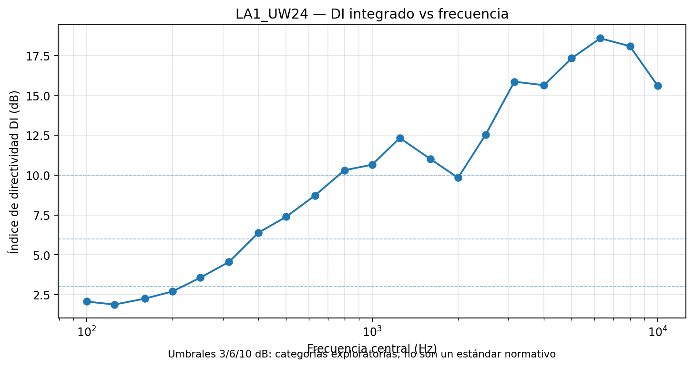
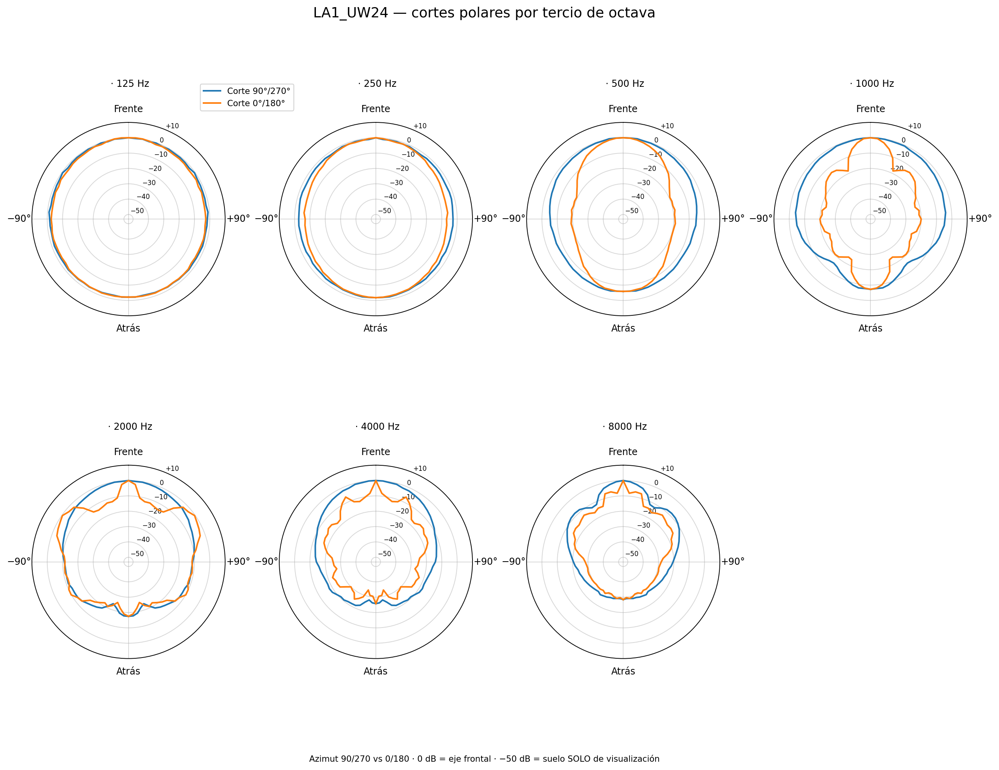

# Relatório técnico de desenvolvimento — CF2 Directivity Analyzer & Summarizer

**Versão documentada:** 0.7  
**Data:** 23 de outubro de 2026  
**Idioma:** português (Brasil)  
**Finalidade:** documentação técnica e metodológica de apoio ao Trabalho de Conclusão de Curso (TCC) e à pesquisa de simulação/otimização acústica  
**Estado do projeto:** caracterização numérica e descrição por banda implementadas; validações geométricas complementares ainda pendentes

> **Síntese:** o software lê a diretividade de alto-falantes em arquivos CLF2/CF2, calcula métricas em cada banda de frequência declarada e gera metadados e explicações em linguagem natural. Seu propósito é tornar os padrões de radiação compreensíveis e auditáveis. **Nesta etapa ele não classifica alto-falantes como bons ou ruins, nem recomenda ou elimina modelos para uma sala.** Essa decisão pertence a um segundo projeto, futuro e independente: *CF2 Speaker Selector*.

## 1. Sumário executivo

O trabalho consolidou um fluxo reprodutível de **leitura → caracterização → descrição → documentação** de alto-falantes. A versão 0.7 oferece dois caminhos de entrada: arquivos `.CF2` originais, que são interpretados com o `cf2_parser_v5.py` e módulos de métricas, ou um CSV de métricas calculado anteriormente, útil para atualizar os textos com menor custo computacional. Em ambos os casos, a saída reúne fichas por alto-falante e descrições por banda de frequência.

No corpus analisado foram identificados **442 arquivos CF2 processados**, **421 conteúdos binários distintos por SHA-256**, **9.552 combinações únicas de arquivo e banda** e **27 frequências declaradas distintas** entre 50 Hz e 20 kHz. O formato prevê **30 frequências centrais**, mas as três menores (25, 31,5 e 40 Hz) não apareceram como bandas declaradas nesse corpus. As diferenças entre 442 arquivos e 421 hashes refletem cópias binárias; não se deve tratar a contagem de hashes como a quantidade de modelos comerciais distintos.

A versão 0.7 foi submetida a **23 testes automatizados**, executados novamente para esta documentação com resultado positivo. O caso real Bosch LA1_UW24 também foi utilizado anteriormente para comparar os índices de diretividade das 21 bandas na entrada CF2 e na entrada CSV.

**Resultados centrais desta fase:**

- Descrição **individual de cada banda declarada**, em três níveis: síntese curta, descrição técnica e interpretação acústica.
- Relatório da **evolução espectral** do mesmo modelo e identificação de transições relevantes.
- **Ficha consolidada** do alto-falante, acompanhada de metadados estruturados reutilizáveis.
- Sinalização de **limitações e incertezas**, em vez de transformar automaticamente anomalias ou ausência de limiares em defeitos.
- Manutenção de uma fronteira explícita entre **caracterização intrínseca da fonte** e **adequação da fonte a um cenário**, que somente será tratada futuramente pelo Selector.

## 2. Motivação e relação com o TCC

Nos estudos de simulação e otimização acústica, a fonte sonora frequentemente é representada por um padrão idealizado (por exemplo, omnidirecional ou cardioide). Arquivos CF2 permitem trabalhar com padrões de magnitude de diretividade declarados para modelos reais, que variam conforme a direção e a frequência. Porém, o volume de dados angulares torna difícil compreender rapidamente as características de cada fonte.

O **CF2 Directivity Analyzer & Summarizer** atende a essa necessidade: construir **metadados descritivos e rastreáveis**, capazes de explicar *o que o padrão contém* antes que outra ferramenta avalie *se o padrão é adequado para determinado experimento*. Essa separação é importante no TCC para permitir que os critérios futuros de inclusão de fontes sejam justificáveis, sem atribuir qualidade acústica apenas a um DI elevado.

**Objetivo geral:** caracterizar e descrever sistematicamente a diretividade de alto-falantes a partir das bandas efetivamente declaradas nos respectivos arquivos CF2.

**Objetivos específicos:** (i) identificar o arquivo e as bandas válidas; (ii) quantificar concentração, cobertura, orientação e distribuição energética angular; (iii) explicar cada banda; (iv) descrever mudanças espectrais; (v) exportar tabelas e metadados em formatos reutilizáveis; (vi) preservar avisos de qualidade e rastreabilidade.

### 2.1. Dois produtos, uma responsabilidade por produto

| Produto | Responsabilidade | Situação |
|---|---|---|
| **CF2 Directivity Analyzer & Summarizer** | Leitura do CF2, métricas, interpretação de cada banda, síntese do alto-falante e catálogo descritivo | **Escopo atual — v0.7** |
| **CF2 Speaker Selector** | Filtrar e comparar candidatos em função de critérios experimentais, sala, regiões-alvo e limitações de simulação | **Escopo futuro — não implementado aqui** |

O primeiro sistema deve ser útil de maneira independente, inclusive para pesquisadores que desejam conhecer um alto-falante sem realizar seleção ou simulação de uma sala.

## 3. Evolução resumida do desenvolvimento

| Etapa | Principal contribuição | Situação nesta documentação |
|---|---|---|
| Parser **v5** | Interpretação binária de magnitudes CF2, eixos angulares, metadados, dados EA e, quando presente, fase V2 | Mantido como base de leitura |
| Analyzer **v0.1** | DI, Q, larguras angulares a −6 dB, frações de potência e gráficos de verificação | Métricas aproveitadas |
| Analyzer **v0.2** | Concentração em cones, divergência Jensen–Shannon entre bandas e candidatos a lóbulos nos cortes | Métricas e ressalvas aproveitadas |
| Etapa **v0.3** | Comparação em todas as bandas disponíveis; remoção do recorte arbitrário até 8 kHz | Princípio preservado |
| Etapa **v0.4** | Distinção entre DI axial e DI na direção do máximo; comparações e análises exploratórias do corpus | Conceitos preservados; agrupamento fora do fluxo principal |
| Etapa **v0.5** | Confrontação visual com referências CLF Viewer e separação do processamento de imagens | Recurso de validação, não requisito do resumidor |
| Summarizer **v0.6** | Catálogo textual a partir de CSV ou CF2 | Base para v0.7 |
| **Analyzer & Summarizer v0.7** | Três descrições por banda, síntese por região espectral, perfil consolidado e metadados versionados | **Versão documentada** |

**Decisão de escopo:** não gerar balloons 3D nem milhares de gráficos como condição para obter metadados. A visualização permanece opcional, direcionada à validação de casos específicos.

## 4. Fontes de dados e representação CF2

### 4.1. Frequências centrais declaradas

O parser possui uma tabela de **30 frequências centrais de terço de oitava**:

```python
CF2_FREQS = [
    25, 31.5, 40, 50, 63, 80, 100, 125, 160, 200,
    250, 315, 400, 500, 630, 800, 1000, 1250, 1600, 2000,
    2500, 3150, 4000, 5000, 6300, 8000, 10000, 12500, 16000, 20000
]
```

O programa **não pressupõe que todas as 30 bandas estejam disponíveis**. Ele utiliza as frequências declaradas por cada arquivo. A extensão da banda declarada tampouco comprova, isoladamente, a faixa útil ou a resposta em nível absoluto do equipamento. Bandas ausentes não são interpoladas e não recebem valores inventados.

**Frequência de amostragem (`fs`):** 44,1 kHz, 48 kHz ou 96 kHz **não são necessárias** para caracterizar diretamente as magnitudes de diretividade por banda armazenadas no CF2. `fs` passa a ser pertinente em estágios de síntese de filtros, respostas ao impulso ou simulação no domínio temporal; não neste relatório.

### 4.2. Discretização angular

Cada banda de magnitude é representada por uma matriz **72 × 37 = 2.664 amostras**, com:

- Azimute: 0°, 5°, 10°, …, 355° (72 valores).
- Ângulo **arc**: 0°, 5°, 10°, …, 180° (37 valores).
- Resolução nominal: **5°** em ambas as dimensões.
- Eixo de referência frontal: `arc = 0°` na interpretação atualmente validada para a estrutura da magnitude.

A associação de pares de azimutes aos **cortes horizontal e vertical** é adotada provisoriamente no módulo de métricas e ainda necessita confirmação independente nos modelos selecionados. O parser preserva o nome original `arc` para não introduzir pressupostos de convenção sem validação.

O `cf2_parser_v5.py` mantém os valores binários originais e **não aplica automaticamente um piso visual**. Certos arquivos contêm amplitudes relativas muito baixas, inclusive valores literais próximos de −200 dB. Esse dado não deve ser transformado em zero nem confundido com o piso de visualização de aproximadamente −50 dB empregado em algumas reproduções de gráficos CLF/CATT.

## 5. Arquitetura funcional

O processamento principal está organizado logicamente da seguinte forma:

```text
               ARQUIVO(S) .CF2
                      │
                      ▼
               cf2_parser_v5.py
                      │
                      ▼
    cf2_directivity_metrics.py + cf2_pattern_metrics.py
                      │
                      ▼
                 Métricas por banda
                      │
                      ├───────────────┐
                      ▼               │
              cf2_describer_v07.py     │
                      │               │
                      ▼               │
          Regras de descrição versionadas
                      │               │
                      ▼               ▼
             summary.md       metadata.json + bands.csv
                      │
                      ▼
                Catálogo do corpus

      Entrada alternativa: corpus_metrics.csv ──────┘
```

A entrada CSV é útil quando as métricas já foram calculadas. **Ela não é necessária** para usar o projeto com arquivos CF2 binários originais.

### 5.1. Saídas geradas

```text
resultados/
├── catalogo_altavoces.csv
├── catalogo_altavoces.json
├── catalogo_bandas.csv
├── catalogo_bandas.jsonl
├── resumo_corpus.md
├── metadatos_ejecucion.json
└── altavoces/
    └── MODELO_<hash>/
        ├── metadata.json
        ├── bands.csv
        └── summary.md
```

O identificador de configuração inclui o **SHA-256** do conteúdo binário. Duas cópias idênticas não devem multiplicar a mesma observação no corpus; configurações ou arquivos binários diferentes devem conservar identidades distintas, mesmo que apresentem o mesmo nome comercial.

## 6. Metodologia de caracterização acústica

### 6.1. Índice e fator de diretividade

Para cada frequência \(f\), os valores angulares relativos em dB são convertidos em **potência linear relativa**:

\[
p(f,\Omega) = 10^{\left[L(f,\Omega)-L_{\mathrm{eixo}}(f)\right]/10}.
\]

A potência média espacial é calculada por integração esférica com pesos de ângulo sólido:

\[
\overline{p}(f)=\frac{1}{4\pi}\int_{4\pi}p(f,\Omega)\,d\Omega.
\]

O fator e o índice de diretividade axial são:

\[
Q_{\mathrm{axial}}(f)=\frac{p(f,\Omega_{\mathrm{eixo}})}{\overline{p}(f)},\qquad
DI_{\mathrm{axial}}(f)=10\log_{10}Q_{\mathrm{axial}}(f).
\]

A implementação faz integração discreta considerando a área angular das células. Portanto, **não é correto tirar uma média aritmética simples das 2.664 amostras**: pontos próximos aos polos representam porções menores da esfera.

### 6.2. Diretividade axial versus direção de máximo

Para fontes com padrão principal deslocado do eixo de referência, o programa registra também:

\[
DI_{\mathrm{máx}}(f)=DI_{\mathrm{axial}}(f)
+\left[L_{\mathrm{máx}}(f)-L_{\mathrm{eixo}}(f)\right].
\]

O máximo é obtido na **malha angular discreta**, e sua direção depende da convenção angular ainda em validação. Um `DI_axial` reduzido **não significa** baixa diretividade em todas as direções; pode apenas indicar que o máximo está apontado para outro ângulo.

### 6.3. Largura a −6 dB e geometria dos cortes

Nos dois cortes associados provisoriamente a H e V, a largura é estimada pela soma dos primeiros cruzamentos para −6 dB em ambos os lados do eixo frontal. São guardados os cruzamentos individuais, a largura total e indicadores de assimetria.

- Se algum cruzamento não existe, o resultado é **não delimitado (`n/d`)**, e não zero ou 360°.
- A medida refere-se ao **eixo frontal**, portanto pode não representar adequadamente o lóbulo principal de um alto-falante com máximo deslocado.
- Valores interpolados como 6,2° não implicam precisão física de 0,1° quando a malha original possui passos de 5°.
- A razão entre as duas larguras, quando ambas são válidas, é um indício de **anisotropia angular**.

### 6.4. Distribuição angular de potência

Outras métricas úteis são:

| Métrica | Interpretação correta |
|---|---|
| Potência relativa em cone frontal de ±30° | Parcela da potência angular integrada próxima ao eixo de referência |
| Potência relativa em cone frontal de ±60° | Concentração relativa em região frontal mais ampla |
| Potência relativa no hemisfério posterior | Quantificação da distribuição angular atrás da fonte |
| Relação frontal/posterior | Contraste direcional entre referência frontal e região traseira |
| Assimetria angular | Diferença de extensões em lados opostos do corte |
| Candidatos a lóbulos secundários | Máximos detectados **em cortes 2D**; não contagem certificada de lóbulos 3D |

Os percentuais descrevem **distribuição espacial relativa de potência**, e não pressão sonora absoluta, eficiência, sensibilidade ou nível SPL em uma sala.

### 6.5. Mudanças entre bandas: divergência Jensen–Shannon

A divergência Jensen–Shannon (JSD) é usada para quantificar quanto a **distribuição angular normalizada** se altera entre frequências contíguas. Uma JSD elevada sinaliza diferença espacial pronunciada, **não** defeito ou qualidade ruim. A comparação só deve ser apresentada quando as frequências correspondem a bandas adjacentes efetivamente identificadas pelo método; não se deve comparar intervalos espectrais arbitrários como se fossem equivalentes.

Além da JSD, pode-se descrever a mudança em `DI_axial`, larguras e posição do máximo entre bandas, sempre mantendo as respectivas limitações.

## 7. Regras descritivas e rastreabilidade

As faixas de DI utilizadas no resumidor são **exploratórias, parametrizáveis e não normativas**:

| DI axial | Etiqueta descritiva |
|---:|---|
| < 3 dB | Pouco diretivo |
| 3 a < 6 dB | Moderadamente diretivo |
| 6 a < 10 dB | Diretivo |
| ≥ 10 dB | Muito diretivo |

Outros limiares implementados incluem razão mínima entre larguras de **1,8** para sinalização de anisotropia, máximo acima do eixo em **mais de 3 dB** para destaque de desvio, e **JSD ≥ 0,10 bit** como evento de mudança espacial pronunciada. O arquivo `config/descripcion_v07.json` registra as regras e possui hash para auditoria.

Para cada banda são produzidos:

1. **Resumo breve:** principal propriedade em termos compreensíveis.
2. **Descrição técnica:** números, unidades e valores relevantes.
3. **Interpretação acústica:** significado do padrão, sem afirmar desempenho em sala.

O estado da interpretação é mantido separado do resultado numérico. Uma banda **condicionada** pode ter DI válido, mas largura não delimitada ou geometria próxima ao limite angular; isso não torna o arquivo inválido. A validação do campo EA é uma **verificação interna** dos valores do próprio CF2, e não uma medição externa de referência.

## 8. Resultados do corpus

### 8.1. Dimensões e consistência

| Indicador | Valor verificado |
|---|---:|
| Registros originais (modelo × banda, incluindo cópias) | **10.002** |
| Arquivos processados no levantamento original | **442** |
| Identificadores binários SHA-256 distintos | **421** |
| Registros únicos (SHA-256 × frequência) | **9.552** |
| Linhas adicionais associadas a duplicações | **450** |
| Frequências centrais declaradas diferentes | **27** |
| Faixa mínima–máxima observada | **50–20.000 Hz** |
| Frequências teóricas na tabela do parser | **30** |

Esses totais foram conferidos diretamente no CSV de métricas usado no trabalho. **Uma frequência ausente não é preenchida por interpolação**, e perfis resumidos de arquivos com faixas espectrais distintas não devem ser tratados como medições equivalentes.

### 8.2. Seis alto-falantes para revisão qualitativa

| Modelo | Bandas | Faixa declarada (Hz) | DI axial máximo (dB) | Frequência do máximo (Hz) |
|---|---:|---:|---:|---:|
| Bosch — LA1_UW24 | 21 | 100–10.000 | 18,58 | 6.300 |
| Danley — SH-25 | 25 | 63–16.000 | 22,37 | 6.300 |
| d&b — M6 | 21 | 100–10.000 | 12,91 | 6.300 |
| CES — SCP-2060 | 21 | 100–10.000 | 12,75 | 6.300 |
| FZ Audio — FZ 1203A | 22 | 100–12.500 | 20,83 | 8.000 |
| d&b — 24C HF 10° | 27 | 50–20.000 | 11,85 | 2.000 |

**Por que esses seis casos são úteis?** O conjunto contém comportamento fortemente anisotrópico (Bosch LA1_UW24), alta concentração em várias bandas (SH-25), um perfil comparativo intermediário (M6), um caso com atenuações posteriores extremas no arquivo (SCP-2060), transições espectrais relevantes (FZ 1203A) e padrão intencionalmente deslocado do eixo (24C HF 10°). Essas observações justificam **diversidade para validação descritiva**, não um ranking de qualidade.

## 9. Estudo de caso: Bosch LA1_UW24

O arquivo binário utilizado na validação direta, `LA1_UW24(4).CF2`, contém **21 bandas entre 100 Hz e 10 kHz**. A maior diretividade axial observada foi **18,58 dB a 6.300 Hz**.

### 9.1. Síntese por regiões espectrais

- **Baixas frequências — bandas presentes de 100 a 250 Hz (5 bandas):** DI axial mediano **2,25 dB**, indicando concentração axial relativamente baixa. Em diversas bandas os cruzamentos completos a −6 dB não estão disponíveis.
- **Médias frequências — bandas presentes de 315 a 2.000 Hz (9 bandas):** DI axial mediano **9,83 dB**. Surgem diferenças expressivas entre as larguras dos dois cortes, com evolução não estritamente monótona.
- **Altas frequências — bandas presentes de 2.500 a 10.000 Hz (7 bandas):** DI axial mediano **15,86 dB**. Em algumas bandas, as larguras em um dos cortes aproximam-se da própria resolução angular, exigindo interpretação condicionada.

A maior alteração espacial entre bandas adjacentes registrada para esse caso ocorreu de **1.250 a 1.600 Hz (JSD ≈ 0,296 bit)**. Isso indica mudança na distribuição angular, sem permitir concluir que exista defeito do transdutor.

### 9.2. Tabela completa de bandas — Bosch LA1_UW24

| Banda (Hz) | DI axial (dB) | DI máx. (dB) | Corte H a −6 dB | Corte V a −6 dB | Estado da interpretação |
|---:|---:|---:|---:|---:|---|
| 100 | 2,07 | 2,07 | n/d | n/d | condicionada |
| 125 | 1,89 | 2,19 | n/d | n/d | condicionada |
| 160 | 2,25 | 2,35 | n/d | n/d | condicionada |
| 200 | 2,71 | 2,91 | n/d | n/d | condicionada |
| 250 | 3,57 | 3,57 | n/d | 135,0° | condicionada |
| 315 | 4,55 | 4,65 | n/d | 86,4° | condicionada |
| 400 | 6,40 | 6,40 | 270,0° | 70,6° | interpretável |
| 500 | 7,39 | 7,59 | 195,6° | 62,9° | interpretável |
| 630 | 8,72 | 8,72 | 182,5° | 50,7° | interpretável |
| 800 | 10,31 | 10,31 | 200,0° | 32,9° | interpretável |
| 1.000 | 10,66 | 10,66 | 200,0° | 30,2° | interpretável |
| 1.250 | 12,33 | 12,63 | 146,7° | 24,5° | interpretável |
| 1.600 | 11,01 | 11,01 | 120,0° | 16,0° | interpretável |
| 2.000 | 9,83 | 9,83 | 115,4° | 14,3° | interpretável |
| 2.500 | 12,55 | 12,55 | 102,9° | 12,5° | interpretável |
| 3.150 | 15,86 | 15,86 | 86,2° | 9,8° | condicionada |
| 4.000 | 15,64 | 15,64 | 93,6° | 7,3° | condicionada |
| 5.000 | 17,33 | 17,33 | 61,1° | 5,6° | condicionada |
| 6.300 | 18,58 | 18,58 | 50,0° | 6,2° | condicionada |
| 8.000 | 18,09 | 18,09 | 38,1° | 7,4° | condicionada |
| 10.000 | 15,62 | 15,62 | 36,5° | 6,5° | condicionada |

Os cortes rotulados H/V utilizam a convenção atual do software e ainda precisam ser confrontados independentemente com as capturas CLF Viewer. **`n/d` significa ausência de cruzamento completo**. As bandas em estado condicionado permanecem no catálogo com suas métricas válidas e notas de limitação.

### 9.3. Exemplos de interpretação por banda

**100 Hz — radiação relativamente ampla.** DI axial de **2,07 dB**; não é possível delimitar ambas as larguras a −6 dB. Aproximadamente **27,8%** da potência angular relativa encontra-se no cone frontal de ±60°, enquanto **46,9%** encontra-se no hemisfério posterior. Interpretação: concentração frontal limitada, com parcela apreciável da potência distribuída para trás.

**1.000 Hz — padrão fortemente anisotrópico.** DI axial de **10,66 dB** (Q ≈ **11,63**); larguras de **200,0°** e **30,2°** nos dois cortes considerados. Interpretação: radiar amplamente em um plano e de forma muito mais restrita no outro é distinto de um feixe cônico simétrico. Não significa, isoladamente, melhor uniformidade na sala.

**6.300 Hz — alta concentração e cautela angular.** DI axial de **18,58 dB**, com larguras de cerca de **50,0°** e **6,2°**. A banda é muito diretiva segundo a escala exploratória; contudo, a menor largura é próxima da resolução de **5°**, de modo que seus decimais não representam exatidão instrumental comprovada.

### 9.4. Figuras opcionais para conferência

As duas imagens seguintes são **materiais auxiliares, já produzidos em etapas anteriores**. Não são exigidas para gerar os metadados nem constituem uma nova validação independente.

**Figura 1 — Evolução do índice de diretividade do Bosch por frequência.**  


**Figura 2 — Conjunto de cortes polares do Bosch em diferentes frequências.** A orientação H/V é mantida como provisória.  


## 10. Estrutura dos metadados resultantes

O perfil em `metadata.json` registra a identidade, a cobertura de frequências, um panorama textual, a metodologia e um vetor `bands` com objetos individuais. Um objeto por banda inclui, entre outros:

| Campo lógico | Conteúdo |
|---|---|
| `frequency_hz` | Frequência central efetivamente declarada |
| `clasificacion_di_axial` / `clasificacion_di_maximo` | Etiquetas exploratórias separadas |
| `metricas` | DI, Q, posição de máximo, larguras, frações energéticas e indicadores adicionais |
| `resumen_breve` | Descrição acessível da banda |
| `descripcion_tecnica` | Dados numéricos contextualizados |
| `interpretacion_acustica` | Significado físico dos dados sem avaliação de qualidade |
| `limitaciones` | Motivos para interpretar com cautela |
| `transicion_desde_anterior` | Comparação com banda anterior, quando pertinente |
| `estado_interpretacion` | Condições de uso do texto e dos indicadores |

Os metadados devem preservar **versão do algoritmo, versão das regras, identificação do arquivo e hash**. Campos de recomendação para sala, de exclusão ou de pontuação de adequação deliberadamente **não fazem parte do Analyzer & Summarizer**.

## 11. Validação, confiabilidade e limitações

### 11.1. Evidência já disponível

- O `cf2_parser_v5.py` é resultado de extensa confrontação empírica com arquivos de fabricantes e leitores externos em etapas anteriores do projeto.
- O corpus foi processado com **zero erros de execução registrados no relatório original**, mas isso não equivale à ausência de incerteza acústica.
- O Bosch foi confrontado internamente com os campos EA do CF2, com boa concordância do fator Q, e as 21 bandas apresentaram consistência numérica entre a rota CSV e a rota binária nos testes documentados.
- A suíte **v0.7 realizou 23 testes automatizados**, executados novamente na preparação deste relatório.

### 11.2. O que permanece pendente

1. **Confirmar a convenção dos cortes H/V** usando referências visuais ou valores angulares independentes. As capturas CLF Viewer existentes permitem essa verificação, sem necessidade de novo levantamento em massa.
2. **Investigar diferenças pontuais nos valores de beamwidth** em relação aos campos EA e definir tolerâncias por resolução e fabricante.
3. **Validar casos de máximo fora do eixo**: por exemplo, um alto-falante inclinado pode apresentar DI axial pequeno e DI na direção de máximo elevado.
4. **Verificar valores extremos como −200 dB** quanto à intenção do produtor dos dados; o parser os preserva literalmente.
5. **Diferenciar alterações espectrais de irregularidades físicas**: JSD elevada, assimetria e candidatos a lóbulos nos cortes não representam, sozinhos, inadequação ou defeito.
6. **Verificar a imagem Docker no ambiente Ubuntu de destino**. Os testes Python foram executados, mas o build Docker ainda não foi validado nesse host.

### 11.3. Referências 2D existentes

A busca de capturas do CLF Viewer encontrou **116 associações únicas** para **cinco** dos seis modelos selecionados: SH-25 (25), M6 (21), SCP-2060 (21), FZ 1203A (22) e 24C HF 10° (27). Não foram identificadas capturas com a convenção de nome esperada para o LA1_UW24 naquela varredura. A ausência de associação **não prova ausência de qualquer imagem**; apenas que nenhuma foi reconhecida pelo manifest naquele diretório e padrão.

Essas imagens podem ser usadas para auditoria de orientação e morfologia do padrão, mas a comparação quantitativa em dB exige escala calibrada ou referência de dados, não apenas sobreposição de pixels.

## 12. Reprodutibilidade e execução em Ubuntu

### 12.1. Entrada direta a partir de um arquivo CF2

A entrada binária é o fluxo principal recomendado. O ambiente Python requer **NumPy**, além da biblioteca padrão usada pelo parser e pelas métricas:

```bash
cd cf2_directivity_analyzer_summarizer_v07

python3 cf2_describer_v07.py \
  --input "$HOME/Documentos/Juan/mba/pyroomacoustic/windows/storage/LA1_UW24.CF2" \
  --output "$HOME/Documentos/Juan/cf2-resultados/bosch"
```

Para processar todo o diretório recursivamente sem CSV anterior:

```bash
python3 cf2_describer_v07.py \
  --input "$HOME/Documentos/Juan/mba/pyroomacoustic/windows/storage" \
  --recursive \
  --output "$HOME/Documentos/Juan/cf2-resultados/catalogo"
```

### 12.2. Ambiente isolado por Docker Desktop

O pacote de código v0.7 contém `Dockerfile.cf2`, sem exigir instalação global de pacotes Python no host:

```bash
cd cf2_directivity_analyzer_summarizer_v07
docker build -f Dockerfile.cf2 -t cf2-summarizer:0.7-cf2 .

CF2_DIR="$HOME/Documentos/Juan/mba/pyroomacoustic/windows/storage"
OUT_DIR="$HOME/Documentos/Juan/cf2-resultados"
mkdir -p "$OUT_DIR"

docker run --rm \
  -v "$CF2_DIR:/cf2:ro" \
  -v "$OUT_DIR:/out" \
  cf2-summarizer:0.7-cf2 \
  --input /cf2 \
  --recursive \
  --output /out/catalogo
```

**Status de verificação:** comando coerente com o modo da aplicação; é necessário executar o build e conferir sua saída no Ubuntu do projeto.

### 12.3. Entrada alternativa por CSV

Quando o corpus já possui métricas, o gerador descritivo pode ser executado com Python sem NumPy:

```bash
python3 cf2_describer_v07.py \
  --input /caminho/para/corpus_metrics.csv \
  --output /caminho/para/resultados
```

Este modo **não volta a verificar fisicamente os padrões CF2**; ele interpreta as métricas disponíveis na entrada. A versão metodológica da origem precisa ser preservada nos metadados.

### 12.4. Testes do software

```bash
python3 -m unittest discover -s tests -v
```

Na preparação desta documentação: **23 testes executados, 23 aprovados**.

## 13. Recomendações para o próximo ciclo do Analyzer & Summarizer

**Prioridade P0 — encerrar a consistência metodológica.** Conferir a correspondência dos cortes por meio de uma pequena amostra de imagens já disponíveis; revisar casos extremos de beamwidth; garantir que o resultado textual não faça afirmações categóricas quando existirem dados limitados.

**Prioridade P1 — melhorar a documentação das bandas.** Acrescentar um campo de *fundamentação da etiqueta* (métrica e limiar que ativaram a frase); padronizar terminologia e idioma do texto exportado; documentar explicitamente os valores não determinados e as transições comparáveis.

**Prioridade P1 — validar perfis contrastantes.** Utilizar os seis modelos da Seção 8.2 para inspecionar manualmente um conjunto representativo de descrições; registrar correções de convenção angular como versões de metodologia, sem alterar os dados originais.

**Prioridade P2 — congelar um contrato estável de metadados.** Consolidar um esquema JSON versionado, testes automatizados de compatibilidade e documentação suficiente para consumo posterior por outro software. **Não incorporar pontuações de seleção nesta etapa**.

## 14. Possíveis contribuições para o TCC

A ferramenta fornece (i) um **método reprodutível** de extração e interpretação de dados de fontes reais; (ii) um **catálogo por banda**, mais informativo que um único índice médio; (iii) **proveniência e tratamento explícito de limites de validade**; e (iv) uma base de metadados que poderá fundamentar futuras comparações de fontes em simuladores.

Uma futura pesquisa poderá perguntar como determinados **atributos de radiação** influenciam soluções de otimização de posição e orientação em uma sala. Esse problema, entretanto, requer simulação da sala, regiões receptoras, condições de contorno e função objetivo, **não podendo ser respondido apenas com o arquivo CF2**.

## 15. Conclusão

A versão **CF2 Directivity Analyzer & Summarizer v0.7** cumpre o objetivo de gerar **caracterizações estruturadas e descrições por banda de frequência** diretamente de arquivos CF2 ou de métricas previamente calculadas. O benefício principal não está na criação de visualizações, mas em tornar a informação angular e espectral **legível, comparável e auditável**.

O projeto deve permanecer centrado na compreensão do padrão de radiação da fonte: **concentração, cobertura, anisotropia, orientação, radiação posterior e evolução espectral**, com ressalvas explícitas. A seleção ou exclusão de alto-falantes para um experimento é um problema posterior e deve continuar em um produto independente.

---

## Anexo A — Glossário resumido

| Termo | Significado |
|---|---|
| **CF2 / CLF2** | Arquivo que contém informações eletroacústicas e dados angulares de um alto-falante |
| **Banda de terço de oitava** | Faixa identificada por uma frequência central nominal |
| **DI** | Índice de diretividade em dB relativo à potência média espacial |
| **Q** | Fator de diretividade, ligado a DI pela transformação logarítmica |
| **Beamwidth / largura de feixe** | Amplitude angular entre cruzamentos com determinado limiar, aqui −6 dB em corte |
| **Anisotropia** | Diferença do padrão em direções/planos distintos |
| **Fração de potência frontal/posterior** | Porcentagem de potência angular relativa em região definida da esfera |
| **JSD** | Divergência Jensen–Shannon: diferença entre distribuições normalizadas |
| **SHA-256** | Identificador calculado sobre bytes do arquivo, usado para rastreabilidade |
| **n/d** | Não delimitado ou não determinado, conforme a grandeza; não implica valor zero |

## Anexo B — Conteúdo do pacote entregue

- `RELATORIO_TECNICO_CF2_v07_PTBR.md`: relatório principal, com referências relativas às figuras.
- `figuras/`: duas figuras 2D auxiliares do Bosch, reutilizadas de análises anteriores.
- `exemplos/bosch_metricas_21_bandas.csv`: tabela numérica resumida dos dados reais do Bosch.
- `exemplos/FICHA_BOSCH_PTBR.md`: exemplo de ficha curta em português.
- `codigo/cf2_directivity_analyzer_summarizer_v07_codigo.zip`: código da versão documentada, para reprodutibilidade.
- `README.md`: orientações de consulta ao pacote.

**Base de evidências:** scripts v0.7, documento de metodologia v0.7, `corpus_metrics(1).csv`, perfis individuais v0.7, resultados de benchmark do Bosch e inventário de referências 2D informado na execução de CLF Viewer. Não foram realizados ensaios novos em sala nem medições físicas neste relatório.
